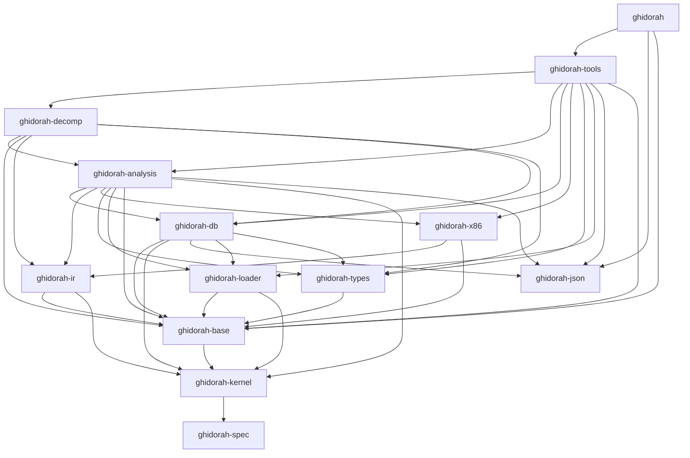

# ghidorah

ghidorah is a software reverse engineering (SRE) framework in Rust, in the spirit of Ghidra.
AI agents are its primary users. A human uses the same command line.

An x86-64 ELF file, a PE32+ file or a raw blob of x86-64 code goes in.
The agent gets bounded, deterministic and undoable facts out: functions, disassembly, cross-references, strings, IR, pseudo-C and function similarity.
Each fact has a stable ID and a why-record.
No tool runs the binary.

## Zero-dependency rule

- The build uses the Rust standard library only. No third-party crate enters the build (ADR-0001).
- `Cargo.lock` has no `source` entry. `.cargo/config.toml` sets `net.offline = true`.
- The workspace has 17 first-party packages. `cargo xtask gates` checks the packages, the crate graph and the lint policy.
- `unsafe` code is only in the dev-only crate `ghidorah-oracle`. The `ghidorah` binary has no `unsafe` code (ADR-0025).

## Quick start for agents

Install the binary from crates.io (Rust 1.97 or later):

```sh
cargo install ghidorah
ghidorah doctor
```

Or build the binary from this tree with the pinned toolchain of `rust-toolchain.toml` (Rust 1.97.0):

```sh
cargo build --release -p ghidorah
./target/release/ghidorah doctor
```

`ghidorah doctor` runs a self-test and prints one JSON object.

### MCP server

`ghidorah mcp` is an MCP server on stdio. It answers the legacy `initialize` handshake and the stateless 2026-07-28 protocol (ADR-0006).
Put this `.mcp.json` file in the root of a Claude Code project:

```json
{
  "mcpServers": {
    "ghidorah": {
      "type": "stdio",
      "command": "/path/to/ghidorah/target/release/ghidorah",
      "args": ["mcp", "--root", "/path/to/binaries"]
    }
  }
}
```

- `--root DIR` names a directory that `binary_load` can read. Send it one time for each directory. The default root is the current directory.
- `--project-root DIR` names the directory of the projects. The default is `$XDG_DATA_HOME/ghidorah/projects`, else `$HOME/.local/share/ghidorah/projects`.
- `--profile readonly` gives the read-only tools. `--profile mini` gives 10 tools for small contexts.
- The `tools/list` result of `full` has at most 24,000 characters (AC-131a). The `mini` result has at most 6,000 characters (AC-131b).
- The server sends its instructions in the handshake. Their workflow line names only the tools of the active profile.
- In the `full` and `mini` profiles, an agent starts with `binary_load`, then `binary_survey`.
- The `readonly` profile has no `binary_load`. Send `--open BIN_ID` to open a project in read-only mode. Then an agent starts with `binary_survey`.

### One call: `ghidorah call`

`ghidorah call <tool> <json>` runs one tool call and prints the result envelope.
Each call is a new session. The project directory keeps the facts and the journal.

```sh
ghidorah call tool_search '{"query":"list the callers of a function"}'
ghidorah call binary_load '{"builtin":"demo"}' --select /data/binary_id
```

`--select` takes a JSON pointer into the envelope. A `*` segment selects each item of an array.

### A session: `ghidorah jsonl`

`ghidorah jsonl` reads one request `{"id", "tool", "args"}` on each line of stdin. It writes one envelope line for each request.
One `jsonl` process keeps one session, so a binary stays open between lines.

```sh
printf '%s\n' \
  '{"id":1,"tool":"binary_load","args":{"builtin":"demo"}}' \
  '{"id":2,"tool":"func_list","args":{"sort":"priority","limit":5}}' \
  '{"id":3,"tool":"func_get","args":{"target":"main","include":["decomp"]}}' \
  | ghidorah jsonl
```

For dependent steps in one call, use `batch_run`. A step takes values of an earlier step with `{"$ref":"s1","ptr":"/data/items/*/id"}`.

## Tool catalog

The `full` profile has 23 tools in this order (design Section 10.3). RO is `readOnlyHint`, DE is `destructiveHint` and ID is `idempotentHint`.

| # | Tool | Purpose | RO | DE | ID |
|---|---|---|---|---|---|
| 1 | `binary_load` | Load an ELF or PE file, a raw blob, the built-in demo or a project by `binary_id`. The load runs the analysis. | no | no | yes |
| 2 | `binary_survey` | Survey a loaded binary: identity, protections, sections, imports, strings, entry points, functions, syscalls and coverage. | yes | no | yes |
| 3 | `analysis_run` | Run or resume analysis with a fuel budget. | no | no | yes |
| 4 | `func_list` | List and filter functions. The sort `priority` puts the important functions first. | yes | no | yes |
| 5 | `func_get` | Get functions with selected sections: summary, disassembly, IR, decompiled C, xrefs, CFG and more. | yes | no | yes |
| 6 | `xref_list` | List cross-references with call-graph depth, call-site context and argument values. | yes | no | yes |
| 7 | `search` | Search names, strings, bytes, comments, notes, types, imports and other kinds, or read records by ID. | yes | no | yes |
| 8 | `mem_read` | Read memory as hex, text, integers, a C type or instructions. | yes | no | yes |
| 9 | `addr_info` | Tell what is at an address. | yes | no | yes |
| 10 | `calc` | Calculate numbers and addresses. | yes | no | yes |
| 11 | `fact_check` | Check claims with supported, refuted or unknown verdicts, and explain why a fact exists. | yes | no | yes |
| 12 | `type_get` | Get a C type with its layout. | yes | no | yes |
| 13 | `history_list` | List the edits since a revision and the analysis runs. | yes | no | yes |
| 14 | `session_brief` | Brief a new context: projects, progress, open notes, findings, edits and orphans. | yes | no | yes |
| 15 | `tool_search` | Search tools and topics. | yes | no | yes |
| 16 | `symbol_rename` | Rename functions, labels, data and variables. | no | no | yes |
| 17 | `comment_set` | Set or clear comments at addresses. | no | no | yes |
| 18 | `note_write` | Write notes, todos, hypotheses, findings and named sets. | no | no | no |
| 19 | `func_edit` | Create or delete functions and override analysis. | no | yes | yes |
| 20 | `type_edit` | Apply a C type or a prototype. | no | no | yes |
| 21 | `history_undo` | Undo or redo your committed edits as new commits. | no | yes | no |
| 22 | `batch_run` | Run up to 32 dependent steps in one call with one transaction for edits. | no | no | no |
| 23 | `func_similar` | Find similar functions, explain each match and propose names. | yes | no | yes |

`ghidorah tools --json` prints the catalog. `tool_search` with `level: "full"` gives the full schema of a tool.
`docs/errors.md` lists the error codes and the warning codes. A failed call gives a repair call in `next[0]` when one exists.

## Architecture

The crate graph is a fixed DAG (design Section 2.2). `cargo xtask deps` writes it to `docs/architecture/crates.mmd`.



| Crate | Purpose |
|---|---|
| `ghidorah-kernel` | Verified leaf: bounded `Reader`, range math, `RangeSet`, flag fusion, budget fit, provenance order. |
| `ghidorah-base` | Addresses, IDs, the error and warning catalogs, limits, fuel, SHA-256. |
| `ghidorah-json` | Strict JSON, JCS and the pointer dialect. |
| `ghidorah-loader` | ELF64, PE32+ and raw loaders, the memory map, imports and protections. |
| `ghidorah-x86` | x86-64 decoder, Intel printer and lifter templates. |
| `ghidorah-ir` | L0 IR, interpreter, graph algorithms and L1 SSA. |
| `ghidorah-types` | C types, the C parser, layouts, calling conventions and prototypes. |
| `ghidorah-db` | Program database, transactions, journal, snapshots and undo. |
| `ghidorah-analysis` | Scheduler, analyzers, function IR, why-records, relations and similarity. |
| `ghidorah-decomp` | Structurer and C printer. |
| `ghidorah-tools` | Tool registry, dispatcher and handlers. |
| `ghidorah` | CLI and MCP server. |

The dev crates are `ghidorah-testkit`, `ghidorah-oracle`, `ghidorah-eval` and `xtask`. They never enter the binary.

## Verification

- Verus proves six kernels of `ghidorah-kernel`: K1 `Reader`, K2 range math, K3 `RangeSet`, K5 flag fusion, K6 budget fit and K7 provenance order (design Section 13.1, ADR-0011).
- The proved code is the shipped code. A std-only stub crate (`ghidorah-spec`) lets plain `cargo` build the same files.
- `verify/results.json` records the last proof run with a tree hash of the proof inputs. A stale record is a warning in plain `cargo test`.
- Under `GHIDORAH_REQUIRE_PROOFS=1`, a stale record fails the kernel test and the record check of `xtask ac`. `xtask ci` and `xtask ac --run` require proofs.
- Each kernel has at least one negative patch in `verify/negative/`. K1, K3, K5 and K7 have two patches.
- The Verus run of each patch must fail with its own expected error kind from `KERNELS` in `xtask/src/verify/kernels.rs`.

Run the proofs:

1. Build Verus commit `ffc9d20` with the steps of `CLAUDE.md`.
2. Set `VERUS` to the `verus` binary and `VERUS_Z3_PATH` to the z3 binary.
3. Run `cargo xtask verify`. The command writes `verify/results.json`.

Other checks:

| Command | Check |
|---|---|
| `cargo test --workspace` | Tier-1 tests with checked-in fixtures only. |
| `cargo test --workspace -- --include-ignored` | Tier-2 tests. They need gcc, clang or objdump. |
| `cargo xtask gates` | The static workspace gates. |
| `cargo xtask cov` | Line coverage per crate. The gate fails when the kernel or a core crate has no measurement. |
| `cargo xtask ste` | The ASD-STE100 check of docs and comments. |
| `cargo xtask fuzz` | Long fuzz runs of each target with 100,000 cases. Failed inputs go to `tests/regress/`. |
| `cargo xtask bench` | The release benchmarks against the budgets of `perf/budget.json`. |
| `cargo xtask ac --run --tier2` | The evidence of each acceptance criterion. It writes `docs/ac-evidence.json`. |

## Documents

- [Design and plan](docs/design.md): scope, architecture, the tool surface, the work packages and the acceptance criteria.
- [Research](docs/research.md): the research that the design uses.
- [Architecture decision records](docs/adr/): one ADR for each decision, with an index.
- [Planning inputs](docs/planning/): the brainstorms and the reviews before the design.
- [Glossary](docs/GLOSSARY.md), [error codes](docs/errors.md) and [license ledger](docs/licenses.md).
- [Agent rules](CLAUDE.md): the commands, the gates and the code rules of this repository.

## License

Apache License, Version 2.0. See [LICENSE](LICENSE) and [NOTICE](NOTICE).
