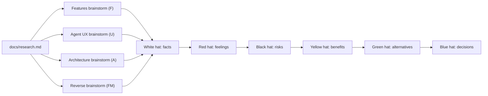

# Planning record: six thinking hats

- Date: 2026-10-16.
- Status: planning input. Sections 1-5 evaluate the brainstorms. Section 6 (blue hat) records the decisions, the open items and the candidates.
- Evidence base: [docs/research.md](../research.md). A reference such as "research 3.4" or "(3.6)" points to a section of that file.
- Inputs: [brainstorm.md](brainstorm.md) (idea IDs `F..`, `U..`, `A..`) and [reverse-brainstorm.md](reverse-brainstorm.md) (failure-mode IDs `FM-..`).

## Method

- The hats run in a fixed order: white (facts), red (feelings), black (risks), yellow (benefits), green (alternatives) and blue (process and decisions).
- Each hat section has a table of points and a list of recommendations. Each point has an implication.
- IDs make the record traceable. A point ID has the form `W-P1`. A recommendation ID has the form `W-R1`. The prefixes are `W` (white), `RD` (red), `BK` (black), `Y` (yellow), `G` (green) and `BL` (blue).
- Section 3.11 of the research holds no evidence. All composition and eval numbers are hypotheses, not facts.

---

## 1. White hat: facts and data

Scope: facts come from docs/research.md sections 1-5 and from new measurements on this host on 2026-10-16. The measurement files are in the research-session scratchpad (`whitehat/` under `/tmp/claude-0/-home-user-ghidorah/240e3b55-981d-585e-9558-61cffd086307/scratchpad`), which is temporary storage. Section 3.11 contains no evidence. Every composition and eval number in the brainstorm inputs is therefore a hypothesis, not a fact.

### 1.1 Points

| ID | Label | Point | Implication |
|---|---|---|---|
| W-P1 | Hard constraint | No third-party crates. vstd needs `verus_builtin_macros`, and that crate pulls in proc-macro2, quote and syn (research 3.10). So any Cargo edge to vstd breaks the rule, also an optional or dev edge. The repo now holds only LICENSE (Apache-2.0), .gitignore and docs/research.md, plus 2 commits. | JSON, CLI, SHA-256, PRNG, property tests, fuzz, bench, MCP and error enums are all first-party code, so they count against the line budget. A Cargo.lock check (no `source` key) plus `net.offline = true` gives a mechanical gate. |
| W-P2 | Measured toolchain | rustc and cargo 1.97.0 (2026-07-07). llvm-tools (llvm-profdata) is installed for the `1.97.0` toolchain only, not for the `stable` alias. A rustup override pins /home/user to 1.97.0. The 1.98.1 toolchain has rustc-dev and llvm-tools for Verus. | `rust-toolchain.toml` must name exactly `1.97.0` with clippy, rustfmt and llvm-tools. Otherwise `xtask cov` cannot find llvm-profdata when it runs outside /home/user. |
| W-P3 | Measured Verus | The binary and z3 4.16.0 are in the session scratchpad under /tmp, and z3 is not on PATH. Verus works only with `VERUS_Z3_PATH` set. The prototypes reader.rs, ranges.rs and undo.rs verify 7, 5 and 4 items, at 1.10-1.25 s each. reader_bug.rs fails with "precondition not met: index in bounds", and ranges_bug.rs fails with "assertion failed". The 4 prototypes total 390 lines. A rebuild costs about 4m31s plus 2m23s for vstd (research 3.10). | Kernels K1-K4 are proven feasible at about 1 s each, and negative twins work. The Verus install is temporary. So `xtask verify` must read `VERUS` and `VERUS_Z3_PATH` and report `{status: skipped}` when they are absent. Record Verus commit ffc9d20 and the build steps. |
| W-P4 | Measured host | 4 cores, 15 GB RAM and 26 GB free disk. gcc 13.3.0, clang 18, ld.lld, objdump 2.42, llvm-objdump 18, llvm-mc 18, readelf, python3, gdb 15, c++filt and llvm-cxxfilt are present. No qemu is installed, and gdb is not multi-architecture (research 3.4, 3.5). | All x86-64 oracles can make goldens locally. For AArch64 and RISC-V, LLVM is the only decode oracle and there is no execution oracle. This is one more fact that keeps those ISAs out of the MVP. |
| W-P5 | Agent host limits | Research 3.9 and 3.2: the tool-name regex is `^[a-zA-Z0-9_-]{1,128}$`, and root anyOf/oneOf/allOf is rejected. Descriptions and instructions are cut at 4,096 chars. Claude Code warns at 10,000 output tokens, caps a result at 25,000 tokens and saves text above 50,000 chars to a file. It cuts error text above about 11,000 chars to the first and last 5,000. One client refused more than 100 tools. | The 40,000-char result cap fits. No brainstorm states the error limit: an isError payload must stay below about 10,000 chars, so candidate lists in `AMBIGUOUS_NAME` and did_you_mean need a top-N cap plus a count. |
| W-P6 | Precision and std traps | Research 3.9 and measured: `0xffffffff81000123` loses its low bits in Node `JSON.parse` and Python float. `str::parse::<f64>` accepts `.5`, `5.`, `+1`, `inf`, `NaN` and `01`. f64 Display prints `NaN`, which is invalid JSON. `println!` panics on a broken pipe. HashMap iteration order is random. | Hex-string addresses, a strict JSON lexer that keeps the raw number lexeme, an EPIPE-safe single writer and a HashMap ban on output paths are fact-driven requirements, not style choices. |
| W-P7 | Decoder facts | Research 3.4: the maximum instruction length is 15 bytes. Over 2,824,260 instructions, 16 mnemonics cover 90%, 68 cover 99% and 153 cover 99.9% of 313. The 1-byte map has 86.5%, 0F 13.1%, VEX 0.26% and EVEX 0.10%. REX is on 47.6% of instructions, and 2.7% are RIP-relative. objdump and llvm-objdump agree on 42.2% of random 15-byte inputs but on 100% of the 241,709 bash boundaries. | Order the semantic tables by frequency. Do not compare display text between oracles. Boundary agreement on real compiler output is a valid 100% gate. VEX and EVEX can decode to length plus an opaque form in the MVP. |
| W-P8 | Flag and lift facts | Research 3.5: 86-91% of eager x86 flag bits are never read. Block-local fusion with snapshot operands covers 98.0-99.0% of flag reads, and reads with more than one reaching writer are at most 0.08%. The core integer lifter set covers bash 99.35%, libc 93.46% and zstd 96.71%/95.46% (gcc/clang). Opaque SSE raises this to 99.99/97.18/99.27/98.87%. angr, VEX and SLEIGH all shipped flag-table bugs (InSPECtor found 125 SLEIGH bugs). | A lazy flag thunk plus a fusion gate of at least 98% are supported by data. libc needs Intrinsic ops for SSE to stay above 97%. The fusion table needs both the exhaustive 8-bit test and the bit_vector proofs at all widths. |
| W-P9 | Discovery facts | Research 3.6: FDEs cover 99.87% of function starts (1,103,832 of 1,105,278) but give 34,772 false starts, mostly cold parts. The FETCH rules cut these to 2,659. Recursive descent alone has about 99.5% precision and about 51% recall. Prologue matching has 77.53% precision. endbr64 starts 99.85% of non-static functions. Missed noreturn calls cause 14.16% of Ghidra-NE misses. Ghidra resolves more than 93% of jump tables at about 90% precision, and 62.63% of its misses come from no `sub` support. | The F1 targets (0.98 with `.eh_frame`, 0.90 without) agree with the literature. A deferral of VSA leaves roughly the `sub` class of jump-table misses open. The agent override (`jumptable_set_targets`) is the planned mitigation. |
| W-P10 | Decompiler facts | Research 3.7: on 7,355 Debian functions with 1,367 source gotos, the goto counts are SAILR 2,673, Hex-Rays 6,115, Ghidra 6,575 and Phoenix 8,497. The median SAILR cost is 1.16 s per function. DecompileBench recompile and execution rates are Hex-Rays 0.583/0.418, Ghidra 0.413/0.278 and angr 0.221/0.140. Raw Ghidra output passes re-execution for about 20% of functions. | No tool reaches high recompile correctness, so recompile success cannot be an MVP gate. Structurer trace-equivalence and goto budgets per fixture are the measurable gates. Zero gotos is not a goal. |
| W-P11 | Reference sizes | Research 3.7, 3.8 and 3.10: Phoenix 3,766 lines of OCaml. LuaJIT `lj_cparse.c` 1,934 lines of C. LLVM Rust v0 demangler 1,259 lines. Itanium 6-12k lines (LLVM about 7k). MSVC about 4.3k. JSON 600-900 lines. SHA-256 about 150. Property-test core about 60. Cooper-Harvey-Kennedy dominators about 30. DecodeBitMasks 15. | The brainstorm estimates are 35% (structurer: 1.3k against 3.8k) and 52% (C parser: 1.0k against 1.9k) of the reference sizes. Rust is usually not denser than OCaml or C. These two items have the highest risk of an underestimate. |
| W-P12 | Measured LOC reconciliation | The totals of the three brainstorm inputs cluster at 33-35k production lines. Features gives 33.5k, architecture about 33k plus 3.3k dev tooling, and reverse 33-35k. That is 94-100% of the 35k ceiling, with no contingency. The components diverge a lot. Analysis: 3.0k (architecture), 4.5k (reverse) and 6.85k (features sum). x86 decoder plus lifter: 4k (architecture, one crate with the lifter), about 7.9k (features) and 9k (reverse). Types: 0.5k, 2.5k and 3k. Per-component minima sum to about 30k, and maxima sum to about 40k. | The expected value sits at the ceiling, and the spread is about ±5k. A cut list with line savings must be fixed before M0, so an overrun forces no unplanned re-scope. The x86 and analysis spreads are the largest unknowns. |
| W-P13 | Conflict | The architecture input puts "core Itanium demangle" plus a C parser, SysV layout, tier-0 prototypes and the Rust demangler in a 3k-line types crate. Research measures Itanium alone at 6-12k lines, and the features input estimates it at about 5k and defers it. | Itanium cannot fit in the MVP. The deferral with a `W_NOT_DEMANGLED` hint is the only budget-consistent option. |
| W-P14 | Measured | rustc 1.97 -O emits v0 symbols. In a hello binary, 543 of 545 text symbols start with `_R` (400 `_RN`, 143 `_RI`). | Without a v0 demangler, every function name in a current Rust target is raw. `xtask cov` lists uncovered functions only by v0 names. At about 1.1k lines (LLVM: 1,259), the Rust v0 demangler is the cheapest demangler with two uses. It is the first candidate to add back if the budget allows. |
| W-P15 | Measured fixture sizes | One small C program compiled with gcc 13.3 (-O0/-O2, PIE/non-PIE) and clang -O2 gives 16,320-16,376 B unstripped, 14,472-14,552 B stripped and 2,283-2,868 B gzip. With `-Wl,-z,noseparate-code`, the stripped size is 6,280 B. The .text is only 577 bytes. | The proposed 160-binary matrix (20 programs x 8 variants) is about 2.5 MB raw. That is above the architecture input's own 2 MiB cap, but about 0.4 MB compressed in git. noseparate-code halves the raw size but changes the `PT_LOAD` layout. Small fixtures do not test scale. |
| W-P16 | Measured compiler defaults | gcc 13.3 (Ubuntu) enables `-fPIE`, `-fcf-protection=full` and `-fstack-protector-strong` (`__CET__=3`, `__PIE__=2`). A default build has `.plt`, `.plt.got` and `.plt.sec`, the IBT and SHSTK property note, a build-id and endbr64. | Every default fixture already uses the CET/PLT/canary path. Non-CET, non-PIE and no-canary fixtures need explicit flags (`-fcf-protection=none`, `-no-pie -fno-pie`, `-fno-stack-protector`). Otherwise the PLT0 lazy-stub path and the absolute jump-table form (`jmp [T+idx*8]`) get no tests. |
| W-P17 | Measured F1 resolution | With 36 truth functions, 1 missed start gives F1 0.986 (pass), and 2 misses give 0.971 (fail). The gate resolution is one function. | The 0.98 and 0.90 gates have statistical meaning only on a corpus of about 500 or more functions. Six first-party fixtures cannot prove them. |
| W-P18 | Measured larger corpus | From the research session: the libzstd gcc -O2 .so is 676,584 B with 565 unique function addresses, 568 FDE starts and 3 .cold parts. The clang -O2 .so is 657,184 B with 530 functions, 532 FDE starts and 0 cold parts. Each is about 268 KB gzip. There are also 24 `-c` objects per compiler with `.rela.rodata`. zstd is dual BSD-3/GPLv2. The zstd version and build flags are not recorded, and the files are in temporary /tmp storage. | About 1,095 functions with symtab truth, real cold-part FDE false starts (exactly 3 = 568-565) and jump-table truth are available under a license compatible with Apache-2.0. That is enough for the F1 and jump-table gates. A pinned build script is necessary before the files are lost. |
| W-P19 | Measured always-present corpus | A Rust hello built by rustc 1.97 -O has 524 functions and 524 FDE starts. It has 252 KB of .text and is 4.36 MB unstripped (345 KB stripped). The cargo test executable (`std::env::current_exe`) is always present at test time and has a full .symtab. | Plain `cargo test` can run no-panic, determinism and F1-against-own-symtab property gates on a large real binary with no external tool. It cannot hold byte goldens, because its output depends on the toolchain. FDE starts equal function starts here, so it does not exercise the cold-part path. |
| W-P20 | Measured bash/libc | bash 5.2.21-2ubuntu4 is GPL-3.0 and 1,446,024 B. libc 2.39-0ubuntu8.9 is LGPL and 2,129,424 B. The bash objdump golden is 14.9 MB (245,528 lines), and objdump makes it in 0.54 s. As a length sequence, the golden has 241,709 entries and is 98 KB gzip (sha256 prefix aced9357d2cce26a). The bash .text is 968,381 B, which gives 4.01 bytes per instruction. | The "100% boundaries on bash and libc" gate and the "analyze bash in 5 s or less" budget cannot run in hermetic `cargo test`. The files are too large, the licenses are GPL/LGPL, and the binaries depend on the host. These gates are xtask oracle jobs keyed to a host-binary sha256. |
| W-P21 | Measured function sizes | FDE ranges: bash has 2,345 FDEs with p50 147 B, p90 833 B, p99 4,663 B and max 15,458 B. libc has 3,788 FDEs with p50 125 B, p90 813 B, p99 6,198 B and max 38,363 B. Of these functions, 2.9% (bash) and 3.1% (libc) are larger than 2,160 B, which is about 540 instructions. | A default disasm page of 200 instructions covers about p90. About 3% of real functions overflow one 40,000-char disasm page, so section cursors in `func_get` are needed in normal use. The decompiler `max_nodes` budget has no measured block-count distribution yet. |
| W-P22 | Measured output shapes | A compact disasm row is 74 chars, so 540 rows fit in 40,000 chars. A func_list object row is about 81 chars (about 490 rows per cap). The columnar table shape saved 42.1% of chars on 500 rows (40,284 to 23,326). The 2,345 bash functions take about 190,000 chars as objects. | The 30-45% table estimate is confirmed for chars. The token saving is not measured. A full func_list of a real binary needs 4-5 pages at the hard cap, or about 24 pages at a default of 100 rows. |
| W-P23 | Measured MCP client | The Claude Code 2.1.301 binary holds the legacy era constant `2025-11-25`, the modern era constant `2026-07-28`, 84 `server/discover` strings and `io.modelcontextprotocol/protocolVersion`. Its log strings show this order: probe `server/discover` first on stdio with a time bound. On method-not-found or no answer, it falls back to `initialize` and remembers the server as a legacy peer. A late answer to the probe is classified as "slow to start". | This partly answers the open question in research 5.2: the main host tries the stateless era first. The server must answer `server/discover` quickly, with a valid result or -32601, or each first connect pays the probe bound. So cold-start latency is a protocol requirement, and the dual-era design is necessary. |
| W-P24 | Unknown | The budget wording "25,000-35,000 lines of production Rust plus tests" has two possible readings. All three brainstorms assume that tests come on top. With an 85-90% coverage target, property tests and goldens, test code is commonly 0.6-1.2x the production code. That ratio is not measured for this project. | This is the biggest blocking gap. If tests count inside 35k, production shrinks to about 16-22k lines, and about half of the current MVP list falls out. The decision changes the scope, not only the order. |
| W-P25 | Unknown | There is no measured delivery rate (lines per hour, defect rate) for AI agents that build std-only Rust under clippy pedantic plus nursery, STE comments, 85% coverage and TDD evidence. Every milestone plan rests on estimates. | Make M0 and M1 the calibration point. Compare actual lines and time with the estimates, then re-plan once. Do not fix the deferral list before this data exists. |
| W-P26 | Unknown | The chars-per-token ratio of ghidorah JSON is not calibrated. The chars/4 rule comes from prose, and hex-heavy JSON probably tokenizes denser. At 4 chars per token, 40,000 chars is about 10,000 tokens, which is the Claude Code warning threshold. At 2.5 chars per token, it is about 16,000 tokens. | The default page sizes, the est_tokens field and every token-cost gate in the eval depend on this one constant. |
| W-P27 | Unknown (host behavior) | The `server/discover` probe bound in ms is not known. It is not known if Claude Code 2.1.301 shows `content[]`, `structuredContent` or both to the model. It is not known if array args still arrive as JSON-encoded strings (issues 22394, 59227 and 73137 were open during 2026). | These facts decide the start-up target, the text-block duplication and how much of the coercion layer is necessary. One logging stub can close all three. |
| W-P28 | Conflicts in the inputs | No evidence picks a winner, and section 3.11 is empty. (1) The composition tool name: batch_run against plan_run. (2) The ref syntax: an RFC 6901 object `{$ref, ptr}` against a `$s1.items[*].id` string. (3) Map semantics: pluck (cap 50/200) against for_each (cap 100). (4) Conditionals: `when` on `$sX.ok` against none. (5) Max steps: 32 against 64. (6) The default transaction: one per batch against one per step plus `atomic:true`. Error-code names also conflict: `CURSOR_STALE`, `STALE_CURSOR`, `INVALID_CURSOR` and `CURSOR_MISMATCH`; `CHANGES_EXPIRED` and `FULL_RESYNC_NEEDED`; `TOOL_NOT_IN_PROFILE` and `PROFILE_FORBIDS_MUTATION`; `BAD_ADDRESS` and `ADDRESS_UNMAPPED`. The binary_survey budget is 6,000 chars in one input and "below 40,000" in another. | Each conflict needs one recorded decision before M0. The error catalog is a frozen numeric list, so a rename later is a breaking change. Only the planned A/B eval can later give data for the composition choices. |
| W-P29 | Evidence quality for agent UX | The external numbers are all vendor-reported single examples, not controlled RE-task measurements. They are: Hex-Rays code mode about 20% fewer tokens; code execution 150,000 to 2,000 tokens; tool search 77K to 8.7K upfront tokens and 79.5% to 88.1% accuracy; input examples 72% to 90%; one workflow instruction 60% to 85%; GhidraMCP agents covered 10-15% of functions. | The proposed gates (tool_search top-3 >= 90%, 100% repair rate, +10% cost regression, survey recall >= 80%) have no baseline. Set them from a first measured eval run, then gate on regression. Do not use them as absolute pass marks from day 1. |
| W-P30 | Coverage measurement fact | Research 3.10: stable 1.97 has no `#[coverage(off)]`, no branch or MC/DC coverage and no doctest coverage. A CLI subprocess writes its own profile and needs its own `--object`. Lines of an inline `#[cfg(test)] mod tests { .. }` are in the instrumented crate, unless a filename filter removes them. | If unit tests stay inline in production files, the 85-90% line number counts test code and is inflated. Separate test files (`mod tests;` in tests.rs) let `--ignore-filename-regex` remove them. |
| W-P31 | Performance budgets are unmeasured | These numbers in the inputs are guesses: decode at 20 MB/s or more, bash analysis in 5 s or less, decompile p50 10 ms or less and p99 300 ms or less, cold start in 50 ms or less, and 64 bytes or less per instruction. The only measured anchors are yaxpeax-x86 at about 250 MB/s (unchecked indexing), SAILR at a median of 1.16 s per function (Python, with a duplicate search) and the Verus kernels at about 1 s each. | The perf numbers can be targets but not gates before M3/M5. They need a hermetic bench input: zstd, the test executable, or a synthetic large ELF made by ElfBuilder. |
| W-P32 | License facts | Research 3.5, 3.8 and 3.9. Allowed with attribution: JSONTestSuite (MIT), iced DecoderTest64.txt (MIT, 43,618 lines), Ghidra noreturn lists (Apache-2.0: ELF 21, PE 28, Mach-O 35 names), LLVM DemangleTestCases.inc (29,931 pairs, Apache-2.0 with LLVM exception), win32json (MIT, but SDK header licenses also apply) and zstd (BSD option). Not allowed in the repo: VEX and QEMU code (GPL), Intel SDM and Arm ASL text (proprietary), radare2 sdb data (LGPLv3), glibc header text (LGPL), and the bash and libc binaries. | A GP subset of the iced vectors gives an oracle-free decoder SPEC in plain `cargo test`. The repo needs a NOTICE file from the first vendored file. |
| W-P33 | Decision, not fact | Ghidra ranks the AI source equal to ANALYSIS (priority 2). All three inputs rank AGENT above ANALYSIS and below IMPORTED. No measurement supports either order. | Record the order as an ADR with its reason (re-analysis must not erase agent work). Do not cite it as evidence. |

### 1.2 Recommendations

- **W-R1.** Ask the owner one question before M0: does the 25-35k budget include test code? Until the answer comes, plan production at about 28k with a hard ceiling of 33k. Also prepare a second cut list down to about 18k. Then a "tests included" answer does not reset the plan.
- **W-R2.** Make M0 plus M1 the calibration step. Record the actual production and test lines and the wall time per milestone with `xtask loc`. If actual/estimate is above 1.2, apply the cut list in its fixed order: crypto constants, format strings, insn_explain, type propagation, emu_run stubs, C parser to sig mode.
- **W-R3.** Pin `rust-toolchain.toml` to exactly 1.97.0 with clippy, rustfmt and llvm-tools. Make `xtask verify` read `VERUS` and `VERUS_Z3_PATH` and report skipped when they are absent. Write Verus commit ffc9d20, z3 4.16.0 and the source-build steps into CLAUDE.md, because the current Verus binary lives only in temporary /tmp storage.
- **W-R4.** Close the MCP host unknowns with one 15-minute probe. Register a 30-line `python3 -I` logging stub with Claude Code 2.1.301. Capture the first request (`server/discover`), the probe time bound, whether array args arrive stringified, and whether the model sees `content[]` or `structuredContent`. Check in the captured lines as golden transcript input.
- **W-R5.** Calibrate chars per token once. Count the tokens of 5 representative outputs (func_list as objects and as a table, disasm page, decompile, error result) with the API token counter or Claude Code /context. Store the constant in the eval config, then derive the default page sizes from it.
- **W-R6.** Build the test corpus in tiers. T1: first-party C fixtures, checked in, with gcc defaults (CET, PIE, canary) plus explicit `-fcf-protection=none`, `-no-pie` and `-fno-stack-protector` variants (about 0.4 MB in git for 160 binaries). T2: zstd gcc and clang .so files plus the `-c` objects (BSD, about 1,095 functions) for the F1 and jump-table gates, with a pinned zstd version and build script. T3: the cargo test executable for no-panic, determinism and own-symtab F1 properties. T4: host bash and libc for xtask oracle jobs only, keyed by sha256.
- **W-R7.** Vendor these MIT and Apache-2.0 vectors in M0 and add a NOTICE file: JSONTestSuite, a general-purpose subset of iced DecoderTest64.txt as the oracle-free decoder SPEC, and the Ghidra ELF noreturn list (21 names).
- **W-R8.** Put unit tests in separate files (`#[cfg(test)] mod tests;` that points to tests.rs), and exclude them in `xtask cov` with a filename regex. Then the 85-90% line target measures production code only.
- **W-R9.** Add an error-payload cap of about 10,000 chars (top 5 candidates plus a total count) next to the 40,000-char result cap, because Claude Code cuts error text above about 11,000 chars.
- **W-R10.** Set the func_get disasm default page to 200 instructions, which covers about p90 of real functions. Give each func_get section its own cursor for the about 3% of functions that are larger than one 40,000-char page.
- **W-R11.** Answer `server/discover` in the first protocol milestone, with a correct result or a fast -32601. Measure the cold start to the first response as a tracked number.
- **W-R12.** Resolve each brainstorm conflict with one decision record before M0. The conflicts are: the composition tool name, ref syntax, map, conditionals, step cap and transaction default; the cursor and error-code names; and the binary_survey budget. Freeze the error-code list after that decision.
- **W-R13.** Treat every eval threshold and every performance budget as provisional. Run the eval once when the composition layer lands, run the benches on zstd and the test executable at M3 and M5, store the measured values as baselines, and then gate on regressions against those baselines.
- **W-R14.** Defer the Itanium demangler explicitly (measured reference size 6-12k lines). Keep the Rust v0 demangler (about 1.1k lines) as the first item to add back, because rustc 1.97 emits v0 names for 99.6% of symbols and xtask cov needs it.

---

## 2. Red hat: feelings and intuition

Scope: gut reactions from an expert reverse engineer and from an AI agent that would use the tool. These are feelings and intuition, not verified facts.

### 2.1 Points

| ID | Point | Implication |
|---|---|---|
| RD-P1 | Excited: the agent-memory spine is the real product. Stable IDs, AGENT provenance, undo, notes, session_brief and changes_since answer the GhidraMCP failures directly: 10-15% function coverage, inconsistent renames and lost context. No other RE MCP server has this built in. | Protect this spine in every cut. It costs less than decompiler polish and builds more trust. If scope must shrink, shrink the decompiler, not the spine. |
| RD-P2 | Excited: the cheap semantic lookups feel like superpowers for CTF and malware triage. These are syscall naming, callsite_args, value_trace, import capability groups, checksec, fixed-form patches and emu_run. emu_run is the "decode this XOR blob" moment. | Do not cut emu_run, even though it is #5 in the features cut order. Keep at least pure-function emulation plus the memset, memcpy and strlen stubs. |
| RD-P3 | Scared of the decompiler. It is about 4k lines of SSA, structurer and SAILR-lite on top of a brand-new lifter. My gut says the C will look clean and be subtly wrong in places. Agents treat pseudo-C as truth, and raw Ghidra output passes re-execution for only about 20% of functions (3.2). | Make the decompiler honest: put fallback_mode, warnings and line_map in every result. Disasm and IR must be the trusted base. The server instructions must tell agents to check a C claim against disasm or IR. |
| RD-P4 | The line budget feels like fiction. Each of the three brainstorms lands on about 33k lines, but each one counts different things. If I add up features, agent UX, eval, xtask and testkit, I feel 40k or more, and tests will be about 1:1. | Freeze a ranked cut list before any code. Ship the triage path end to end first: load, survey, functions, disasm, xrefs, strings, notes, undo. Add the decompiler only after that path is green. |
| RD-P5 | Over-engineered: the stack of quality gates. It has Verus K1-K5, proof stamps, negative twins, mutants-lite, a hermetic PATH run, a counting allocator, per-crate coverage, deny-mode STE from commit one, a file-size lint, an unsafe audit and golden headers. Each gate is defensible. Together they eat a large part of one session. | Tier the gates. Day 1: zero-deps, determinism, never-panic fuzz and registry_matrix. Add the rest at milestones. A gate that blocks the end-to-end path early is a delivery risk. |
| RD-P6 | Verus feels right for the Reader, range math, RangeSet and the bit_vector fusion widths (K1, K2, K3, K5). An undo-law proof on an abstract map (K4) proves little that the model test with a clone stack does not already catch. | Keep K1, K2, K3 and K5. Defer K4 and rely on the model-based undo/redo test. |
| RD-P7 | The real 3.11 risk is already visible: the composition designs disagree. One uses batch_run with RFC 6901 refs and pluck. One uses plan_run with `$s1.items[*].id`, for_each and when. One uses batch_run with a for_each cap and an optional atomic flag. The transaction rules also conflict: always one transaction, atomic:true opt-in, or one transaction per step. | Pick one design in an ADR before anyone writes the executor. Smallest choice: RFC 6901 refs plus pluck, no for_each, no when, and one transaction per batch for all mutations. |
| RD-P8 | As an agent with a shell, I would use `ghidorah call` in a bash or python3 loop far more than batch_run. batch_run matters mostly for hosts that have only MCP. | Make the stateful CLI excellent first, with `--select` and exit codes. Keep batch_run small. Measure with the A/B eval before you add more composition features. |
| RD-P9 | The eval harness measures the tool surface, not the agent. That is fine, but give it an honest name. The repair robot and the hint-reachability walker feel great and cheap. The tool_search recall gate feels self-graded: the same agents write the descriptions, the synonyms and the 60 intents, so it passes 90% by construction. | Write and freeze the intents before the descriptions. Take phrasings from real GhidraMCP and ida-pro-mcp issues. Also run a few manual live-LLM sessions through the recorder and keep them as regression transcripts. |
| RD-P10 | est_tokens = chars/4 feels wrong for this output. Hex addresses, mnemonics and JSON punctuation tokenize much worse than prose (my gut: 2-3 chars per token). | The cost baselines and budgets will under-count. Calibrate the factor once offline on real fixture outputs and store it in `eval/thresholds.json`. |
| RD-P11 | I dislike pseudo-C and disasm inside a JSON string with `\n` escapes. It is hard for a model to read and it costs tokens. | Send code views as a plain-text content block with addresses inline. Put the metadata in structuredContent. Let the A/B eval settle the open question "JSON or compact text". |
| RD-P12 | A stale cursor on every commit will feel like friction. Agents mix note_write and reads all the time. A note must not break a func_list page. | Tie cursor staleness to the epoch of the tables that the query reads, not to the global rev. As an alternative, let a read pin a rev. |
| RD-P13 | The fixtures feel too small. An F1 >= 0.98 on 6-20 tiny C programs proves little. The bash and libc gates cannot run in cargo test, because GPL/LGPL binaries do not belong in an Apache-2.0 repo. | Add one realistic, license-clean fixture: the sqlite3 amalgamation (public domain) and/or Lua (MIT), at -O2, stripped and unstripped. Use it as the main gate for discovery, jump tables and goto budgets. |
| RD-P14 | The MVP target is narrow: gcc or clang C on Linux x86-64. Real targets are often C++, Go or Rust. Raw mangled names with `W_NOT_DEMANGLED` feel honest, and a raw name is better than a wrong partial demangle. | Say this up front in binary_survey (for example, "C++ or Go detected, names not demangled"). Put Go pclntab and Rust v0 early after the MVP, because they cost little and add high value. |
| RD-P15 | What makes me trust a tool: it shows its work. Function starts carry confidence and `why[]`. Reads during analysis carry `partial:true`. Truncation is explicit. An ambiguous name gives `AMBIGUOUS_NAME`, not a guess. Every line has an address. What makes me distrust a tool: clean output with no caveats. | Show provenance, confidence and the partial flag in concise mode too, not only in detailed mode. |
| RD-P16 | I distrust agent rename hallucination. AGENT ranks above ANALYSIS, so a confident wrong guess survives re-analysis forever. | Let a rename carry optional confidence and evidence. session_brief lists names that have weak evidence. The rename lint flags names that look like guesses. |
| RD-P17 | "Persist facts, re-analyze on open" is elegant. My fear: an analyzer upgrade moves function boundaries, and agent facts then sit on addresses that are no longer function starts. | Replay reports orphaned facts as warnings. An agent func_create is itself a persisted fact, so the boundaries that agent work depends on survive an upgrade. |
| RD-P18 | The ID grammar already drifts between brainstorms: `f@401130/v/stack:-0x14` vs `var:0x401130/stack:-0x14`, and `imp:libc!puts` vs `imp:libc.so.6!puts`. | Freeze one grammar in an ADR, with a `parse(display(id))` round-trip test, before anyone writes a tool. A late change to the ID grammar breaks journals and goldens. |
| RD-P19 | Dual-era MCP feels like double protocol work for a client mix nobody knows yet (open question 5.2). | Build the legacy initialize path first, with golden transcripts. Add the 2026-07-28 stateless mode as a thin adapter over the same dispatcher. |
| RD-P20 | Job polling for analysis feels heavy on small binaries. Agents waste calls in poll loops. | binary_load runs triage analysis synchronously within a fuel budget and returns `partial:true` when it stops. Keep analysis_start and job_status for large binaries only. |
| RD-P21 | The tool count will creep past 25. The lists already add analysis_start, job_status, history_redo, mem_read, patch tools and more on top of the base 22. | Turn on the catalog-size gate from day 1. Merge tools into `include[]` and `kinds[]` aggressively. |
| RD-P22 | Deny-mode STE on agent-facing text is right. Deny-mode STE on every code comment from commit one will make coding agents fight a heuristic lint. | Use deny mode for tool descriptions, hints and error messages. Use warn mode for code comments. |
| RD-P23 | Hostile-string escaping, path-root limits and "binary text is data" make me trust running the tool on malware. The legacy tool-name aliases are a small, clever fix for the most likely first mistake. | Keep these and test them early. They cost little and agents notice them. |

### 2.2 Recommendations

- **RD-R1.** Before any code, write one ADR for composition: RFC 6901 refs plus pluck, no for_each and no when, one transaction per mutating batch. Retire the plan_run variant.
- **RD-R2.** Freeze the ID grammar and the address-expression grammar in an ADR, with a round-trip property test, before writing tools.
- **RD-R3.** Order delivery so that the triage spine works end to end before the decompiler starts. The spine is load, survey, functions, disasm, xrefs, strings, notes, undo and session_brief.
- **RD-R4.** Make the decompiler honest by default: fallback_mode, warnings and line_map in every result, and a server-instruction line that says to check C claims against disasm or IR.
- **RD-R5.** Move emu_run (pure emulation plus basic libc stubs) out of the cut list.
- **RD-R6.** Add a license-clean, realistic fixture (sqlite3 amalgamation, public domain, or Lua, MIT) as the main gate for discovery, jump tables and goto budgets. Keep bash/libc gates as optional oracle jobs only.
- **RD-R7.** Tier the quality gates. Day 1: zero-deps, determinism, never-panic fuzz and registry_matrix. Add Verus K1/K2/K3/K5, coverage and mutants-lite at later milestones. Defer the K4 proof.
- **RD-R8.** Calibrate est_tokens on real fixture outputs instead of chars/4.
- **RD-R9.** Write and freeze the tool_search intents before the descriptions, and take phrasings from real issues of other RE MCP servers. Record and keep a few manual live-LLM transcripts as regression traces.
- **RD-R10.** Return code views (pseudo-C, disasm) as a plain-text content block, and put metadata in structuredContent. Settle the default with the A/B eval.
- **RD-R11.** Scope cursor staleness to the tables a query reads, so that note or comment writes do not break unrelated pages.
- **RD-R12.** Run triage analysis synchronously in binary_load within a fuel budget, and keep job polling for large binaries only.
- **RD-R13.** Let agent renames carry optional evidence and confidence. Show names with weak evidence in session_brief.
- **RD-R14.** On project open, report agent facts that no longer attach to a function as warnings.
- **RD-R15.** Use deny-mode STE for agent-facing text and warn-mode STE for code comments.
- **RD-R16.** Name the MVP scope plainly in docs and in binary_survey output: C on Linux x86-64 ELF. Report C++, Go and Rust detection with a hint instead of a silent gap.

---

## 3. Black hat: caution, risk and critical judgement

Scope: this hat checks the candidate scope and architecture against docs/research.md and against the research-session prototypes. The prototypes are `scratchpad/hy2`, which proves a hybrid Reader, and `scratchpad/vproofs/ranges.rs`, which proves half-open ranges with an insert that rejects overlap and has no coalescing, remove or union. Main finding: the three brainstorms each fill the whole budget by themselves. They also disagree on several core decisions: composition, facts vs derived data, transaction scope, and range representation. If the plan does not reconcile these first, it will overrun and contradict itself.

### 3.1 Points

| ID | Point | Implication |
|---|---|---|
| BK-P1 | Budget arithmetic does not close. The features spine alone is 23.9k lean LOC plus 4.3k infra. Agent UX adds about 1.5-2k of extra executor, budget and cursor code. Architecture adds a 1.2k kernel, a 1.3k JSON crate and about 3.3k of testkit and xtask. The union is about 38-42k. The research comparators show that several estimates are too low. Phoenix is 3,766 OCaml lines, but the structurer estimate is 1,300. LuaJIT `lj_cparse.c` is 1,934 C lines, but the estimate is 1,000. The x86 `MAP0[256]` and `MAP1[256][4]` tables come to about 1,300 rustfmt rows before the group, 0F38, 0F3A and VEX tables. The research puts Itanium at 6-12k, not 5k. | With realistic inflation of 1.15-1.3x (pedantic lints, no unwrap, checked arithmetic, hand-written error enums), the spine alone is about 30-33k. Almost none of the 3.6k multipliers or the 1.8k stretch items fit. If tests count toward the budget, even the spine does not fit. |
| BK-P2 | Several costs are in no estimate. (a) Hand-written JSON encode and decode for every persisted fact type and every tool output type (no serde), about 1.5-2.5k LOC. (b) An error enum with Display, `std::error::Error` and `code()` per crate, about 14 x 60-100 LOC. (c) Doc comments in STE on every pub item. (d) The xtask suite: about 18 subcommands (deps, size, unsafe-audit, mutants-lite, test-hermetic, ac, budget, bench --check and others). (e) The eval harness with about 15 metric families. | Meta-tooling and boilerplate could take 6-8k lines away from the product. The plan can then end with every gate built and the product incomplete. Each extra gate is also one more way for the session to stall. |
| BK-P3 | The budget has no counting rule. "Production lines" does not say how doc comments, const tables, `#[cfg(test)]` modules or tests/ files count. "Plus tests" does not say if tests are inside the 25-35k. With 85-90% coverage, property tests and goldens, test code is usually 1-1.5x the production code. | The xtask loc and budget gates cannot be enforced or trusted. A real total of 70-90k lines in one session is a major delivery risk that nobody has acknowledged. |
| BK-P4 | The composition layer has four competing designs. Agent UX proposes batch_run: RFC 6901 `$ref` and pluck, no loops, and every mutating batch is one atomic transaction. Architecture proposes plan_run: for_each, when, a `$s1.items[*].id` grammar, and composites as stored plans. Reverse FM-52/53 proposes for_each capped at 100, resume tokens, and one transaction per step by default with atomic as an opt-in. Research 3.9 still has edit_batch. The CLI `ghidorah batch` is yet another JSONL mode. | This is exactly the 3.11 pitfall: a second, inconsistent surface. The transaction semantics conflict directly (always atomic vs per-step by default). Each extra construct (for_each, when, path grammar) adds a parser, a fuzz target, error codes and budget interactions. If binary_survey becomes a stored plan, its per-section sub-budgets are coupled to the plan engine, and the documented first call breaks when the plan engine has a bug. |
| BK-P5 | The facts-vs-derived model contradicts itself. Features says snapshots hold only facts above ANALYSIS, and open means deterministic re-analysis plus replay. Architecture says code units, functions and refs are facts, an analysis run is one transaction, and undo restores the snapshot taken before the run. Features also adds on-demand local analysis "within max_ms" that writes ANALYSIS facts in call order. | State becomes path-dependent. Local-then-full analysis can end in a different state than full analysis alone, because nothing deletes ANALYSIS facts from bad local seeds. Incremental re-analysis after agent edits, patches or undo can differ from analysis from scratch. Undo is linear, so undoing an agent edit made before an analysis run first requires undoing the run. Agent facts keyed to function entries become orphans when an analyzer upgrade changes the function set. |
| BK-P6 | The plan uses state_hash as "the one equality", computed as SHA-256 over a JCS dump of all tables. For a program the size of bash, the snapshot is tens of MB of JSON. The plan uses state_hash for expected_state, determinism gates and every model-test step. | If state_hash runs per commit or per model step, every rename costs a full serialization and an in-house SHA-256. That is seconds in debug builds. Model tests and agent edit latency then become too slow. |
| BK-P7 | Verus scope is underestimated. The prototypes prove only: a hybrid Reader; half-open intervals whose insert fails on overlap (no coalescing, remove or union); and a byte undo log in a pure `verus!` block, not in hybrid form. Architecture asks for more: inclusive `[first, last]` ranges, which invalidate the interval prototype; coalescing insert, remove and union; `IntervalMap<V>`; an abstract undo law; and bit_vector fusion proofs at 4 widths. The `&mut` spec syntax changed in 2026, and model training data shows the old form. The hybrid Reader indexes with `self.buf[self.pos]` after a proof, which conflicts with a deny on indexing_slicing and arithmetic_side_effects. | Expect many agent iterations per kernel. A freshness stamp that fails plain cargo test blocks all kernel edits whenever Verus is unavailable. A new container needs a 4.5-7 minute rebuild, and GitHub release downloads return 403. |
| BK-P8 | Some of the proofs risk being theatre. A Vec-backed sorted RangeSet has O(n) insert. Function bodies and pending sets for 241k instructions can fragment into quadratic work, so people will be tempted to use a BTreeMap set in production, outside the kernel. K4 proves an abstract map law, not the inverses of the real Edit enum. | The proofs then give confidence for code that does not ship, or for properties weaker than what the model-based clone-stack test already checks. |
| BK-P9 | The mandatory, tool-free test suite has no expression-level semantic oracle for the decompiler. Structurer trace-equivalence checks only control flow. The recompile and behavior harness needs gcc, so it reports skipped. Wrong folding across aliasing memory, a wrong fusion entry, wrong parameter recovery or a wrong stack-variable merge all produce plausible C that no gate catches. Research 3.2: raw Ghidra output passes re-execution for only about 20% of functions. | Agents will reason from C that looks clean but is wrong. That is the worst failure mode for an agent-first decompiler, and the planned gates cannot see it. |
| BK-P10 | The native oracles are hazardous to run inside cargo test. The `asm!` oracle needs an RWX mmap, which hardened kernels and SELinux can deny. A faulting instruction form (div by zero, int3, a bad memory operand, a privileged opcode) kills the test process with a signal, and catch_unwind cannot catch a signal. ptrace co-simulation adds the same class of problem. | If any brainstorm idea puts the "in-process asm! native flag oracle" into plain cargo test, the hermetic suite becomes host-dependent and flaky. |
| BK-P11 | The fixture and oracle plans have license and hermeticity traps. The gate "100% boundary agreement on bash and libc" would put GPL-3 bash or LGPL libc binaries, or their objdump listings (about 241k lines for bash), into an Apache-2.0 repo. Static glibc fixtures for syscall or FunctionID work embed LGPL code. The architecture fixture matrix (about 20 programs x 2 compilers x 2 optimization levels x PIE/non-PIE x stripped/unstripped = about 320 binaries) cannot fit the 2 MiB cap. The test-hermetic plan trims PATH to the cargo and rustc directory, but rustc on x86_64-linux-gnu links through cc, and here /usr/bin/cc is gcc. | There is redistribution risk and repo bloat. The hermetic test as described fails at link time, not at test time. |
| BK-P12 | Goldens are brittle, and blessing them is easy. The plan has full-text pseudo-C goldens per fixture function, byte-exact MCP transcripts (serverInfo version, time-rate-limited progress notifications), a tools.json snapshot, readelf and objdump goldens, and an eval baseline with a ±10% character gate. Golden headers hash the fixture, not the generator code. | Each printer, structurer or description change touches hundreds of files. An AI builder under time pressure will bless them all at once and lock in regressions (FM-45). Notification timing makes transcripts nondeterministic. |
| BK-P13 | The lint regime will cause friction. The plan denies pedantic and nursery lints, sets too_many_lines to 100, and denies cognitive_complexity (a nursery lint that is noisy). It denies indexing_slicing and arithmetic_side_effects broadly, and missing_docs with STE prose. It runs a regex STE lint in deny mode from the first commit. Research 3.10 already says that the regex STE checker gives false positives and that address code is noisy under these lints. Decoder tables and lifter match arms are long by nature. | Agent cycles go into rephrasing comments and splitting functions to satisfy the lints instead of into building features. Large expect and allow lists then make the gates meaningless. |
| BK-P14 | Test-suite runtime puts throughput at risk. Plain cargo test as proposed includes 2k-10k fuzz iterations for each of 8 targets, model checks of 200 steps that clone the Program, two-process full-pipeline determinism on all fixtures, about 33M exhaustive fusion evaluations, and schema fuzzing of 10k cases per tool. It all runs in debug builds with overflow checks. | Several minutes per test run, repeated over hundreds of edit-test cycles, materially cuts what one session can deliver. |
| BK-P15 | The protocol layer has churn and self-validation risk. 2026-07-28 is about 2.5 months old, and which era Claude Code sends by default is still open (5.2). The only tests are goldens that the project writes itself. FM-12 answers batch arrays with -32600 but advertises 2025-03-26, which permits batches. Adding resultType to legacy results assumes that strict clients ignore unknown fields. It is unknown whether hosts show `content[]`, structuredContent or both to the model. | If hosts show both, every result costs about 2x tokens, and all eval character metrics are wrong by that factor. The server can also be correct against its own goldens and still fail with a real client. |
| BK-P16 | The address input rule can edit the wrong place without notice. Under "a digits-only string is decimal, with did_you_mean for the hex reading", both readings can be mapped in a small PIE. Example: `4096` and `0x4096` both fall inside the 0x1000-0x5000 text range. A mutating call then edits the wrong address with no error. Research 3.2: Binary Ninja requires a `0n` prefix for decimal, and models often write hex without `0x`. | This is a silent wrong edit. It is the same class of failure as FM-04, and the provenance lattice makes it sticky. |
| BK-P17 | The eval harness rewards the wrong behavior and measures itself. The "repair robot" applies `candidates[0]` on `AMBIGUOUS_NAME` and counts that as a success. That is the "pick the first match" anti-pattern that FM-04 forbids. The same builders write the reference trajectories, so the harness checks the surface cost of known paths, not agent quality. | A 100% recoverability gate can push the design toward auto-resolution that hides real mistakes. Reports may overclaim agent quality, and 3.11 has no evidence to calibrate that claim. |
| BK-P18 | Prompt injection can persist. Escaping control characters does not neutralize plain ASCII instructions. Many strings are binary-derived: symbol, section, DT_NEEDED, note and demangled names flow into did_you_mean lists, `AMBIGUOUS_NAME` candidates and next-call args. Agent notes can quote binary text, and session_brief serves that text back to a fresh context as trusted memory. | A sample can plant instructions that survive a context reset and come back looking like the agent's own findings. |
| BK-P19 | Project placement and lock handling are unsafe for malware work. A default project dir under cwd copies each sample into `bin/<sha256>` inside the user's git working tree. export_patched writes executable variants. A pid-only stale-lock test is unreliable in containers (pid reuse, pid namespaces). Two Claude sessions on one project make the second writer fail. | Malware can be committed or pushed by accident, antivirus tools can quarantine files, and agents get confusing lock failures. |
| BK-P20 | Crash recovery depends on fragile mechanisms. The plan rolls back in the Drop of a Tx during unwinding, but a second panic in that code aborts the process. It clears mutex poison after a half-applied state. OOM and stack overflow abort the process regardless. Braun's readVariable is naturally recursive, and a 200k-block chain overflows the stack. Derived caches (decompile results, per-function L0) have no size bound. | One bad sample can still kill the server. Because of the plan's own design choices, catch_unwind covers less than the plan assumes. |
| BK-P21 | Some budgets and outputs are nondeterministic. The plan uses time budgets (on-demand analysis "within max_ms", the decompiler max_ms, time-rate-limited progress). It emits floats: Shannon entropy and similarity scores are f64, and libm and formatting differ across hosts. | Goldens and two-process determinism pass on the build host and fail on other hosts or under load. Prompt caching breaks. |
| BK-P22 | Some IDs are less stable than the plan claims. `OpId{addr, seq}` depends on the lifter version, and VarId depends on SP analysis output. Notes evidence and agent variable renames that use these IDs become orphans after a lifter or SP analysis change. | "IDs never change" holds only for address-level IDs. Persisted agent work can silently detach from what it described. |
| BK-P23 | Several in-scope items have poor value for their risk. ELF32 and big-endian loading have no matching decoder, so they serve survey only. Full SSE/AVX/EVEX operand semantics cover VEX at 0.26% and EVEX at 0.10% of instructions. Architecture plans a "core Itanium" demangler while features defers Itanium, and wrong names are worse than raw names. The lazy profile, legacy alias table and 3-level tool_search ranking repeat what hosts already do with native deferred tool search (this session itself loads tools that way). emu_run results can look trustworthy even where the lifter has coverage gaps. A full-declaration C parser sits on the Tier-0 prototype critical path. | These items take 3-6k LOC of the scarce budget and add correctness risk, but do little for the x86-64 ELF end-to-end path. |
| BK-P24 | Ranking AGENT above ANALYSIS locks in mistakes. A wrong func_create or jumptable_set_targets from an agent overrides analysis permanently, and agents make such mistakes often. The plan has no signal for when analysis disagrees with an override. | Wrong CFGs and function bodies persist across re-analysis, the errors compound, and nothing reports them. |
| BK-P25 | Size previews and fan-out are expensive. To report exact omitted-section sizes, a concise func_get must render the decompile anyway. pluck over 50-200 functions then means many full decompiles that return few characters. Nested per-item, per-section cursors make the BoundedWriter complex. A naive std-only glob is exponential on patterns such as `*a*a*a*`. Damerau-Levenshtein over up to 4M symbols for each failed lookup is expensive. | There are CPU denial-of-service paths and latency spikes in calls that the plan calls cheap. Cursor bugs then appear in the most complex shape. |

### 3.2 Recommendations

- **BK-R1.** Before design freeze, define the LOC rule in an ADR. Production LOC = non-blank, non-comment lines under `crates/*/src`, excluding `#[cfg(test)]` modules and tests/. Count const table files on a separate line of the ledger. Set a must-ship core ceiling of 27k with a checkpoint at 31k. xtask loc enforces per-crate entries in `docs/budget.json`.
- **BK-R2.** Cut these from the MVP and say so explicitly: ELF32 and big-endian acceptance (keep the endian-generic Reader and return `UNSUPPORTED_FORMAT`); VEX/EVEX operand semantics (keep the complete length layer and lift these instructions as Intrinsic with conservative def/use sets for the full vector registers); every demangler, Itanium and Rust v0 (`W_NOT_DEMANGLED`); the lazy profile, legacy alias table, 3-level tool_search ranking and the 60-intent discoverability eval; crypto constants; format-string inference; prototype-driven type propagation; emu_run import stubs; on-demand local analysis.
- **BK-R3.** Reduce the C parser to sig mode plus plain struct declarations without bit-fields, pragma pack or attributes. Store Tier-0 prototypes as C signature text checked by a test, so a parser bug fails cargo test, not the server at runtime.
- **BK-R4.** Build one composition tool, batch_run. Steps are `{id, tool, args}`. A ref is `{$ref: step_id, ptr: RFC 6901 pointer, pluck?}`. There is no for_each, no when, no nesting and no path grammar, and a batch has at most 32 steps. Batch-first tools give map over pluck. One fuel budget and one character budget cover the whole batch. A batch with any mutation is always one atomic transaction (no per-step mode). Remove edit_batch. binary_survey and func_get stay plain handlers, not stored plans. Rename the CLI JSONL mode to `ghidorah jsonl` to avoid the batch name clash. The ADR marks this design as a hypothesis for the eval to confirm.
- **BK-R5.** Write the facts-vs-derived ADR. ANALYSIS-rank results are a pure function of (input bytes plus patches, analyzer version and config, facts above ANALYSIS rank). They are never journaled. A snapshot caches them under an input hash, so open can skip re-analysis. Undo touches only facts above ANALYSIS rank and patches, then re-queues the affected ranges. On-demand or local results are never committed. Add the key property test: after random agent edits, patches and undos, incremental re-analysis gives the same state_hash as analysis from scratch.
- **BK-R6.** Handle orphaned facts explicitly. A fact whose anchor (function entry, OpId, VarId) is gone after re-analysis becomes orphaned with `W_FACT_ORPHANED`. It stays listed and can be re-attached, and it is never deleted. Lower-rank sources can never delete an object that carries a higher-rank fact.
- **BK-R7.** Cut Verus to these kernels: K1 Reader (the hybrid already works); K2 checked range math and va_to_file; K3 RangeSet find and coalescing insert only (no remove or union); K5 bit_vector proofs for X86Sub, X86Logic and X86Add x 16 cc x 4 widths. Drop K4, because the clone-stack model test is stronger evidence. Do not use Verus on the decoder. Choose the range representation once. If it is inclusive, budget a re-proof, because the prototype is half-open. Time-box each kernel. When a kernel does not verify inside the time box, record it as "unproven" in `verify/results.json` and rely on its property tests.
- **BK-R8.** Make proofs binding but never blocking. The proof freshness check fails in xtask ci, and in cargo test only when `GHIDORAH_REQUIRE_PROOFS=1`. Otherwise it prints a warning. Give the kernel crate a documented exception for indexing_slicing and arithmetic_side_effects, with the reason "bound proved by Verus". Freeze the kernels early. Production must use the verified RangeSet. If it is too slow, change its structure inside the kernel, never in a parallel set type outside it.
- **BK-R9.** Add a tool-free semantic oracle for decompiler expressions. Extend the structurer AST interpreter to compute values over the Expr/Stmt view, with the same memory model as the L0 interpreter. Compare its results with the L0 interpreter on random inputs, for every fixture leaf function and for randomly generated L1 programs. Keep the gcc recompile harness optional.
- **BK-R10.** Keep native oracles out of cargo test. xtask oracle runs each curated instruction form that cannot fault in a separate child process, then writes JSONL vectors to the repo. cargo test only replays these vectors. Drop ptrace co-simulation from the MVP.
- **BK-R11.** Fixture policy: build only first-party C sources on the host. Never put system binaries or their listings in the repo. Do not link glibc statically: for static and syscall fixtures, use `-nostdlib` with a project-written `_start`. Cap the matrix at about 12 programs x {gcc -O0, gcc -O2 PIE, clang -O2} plus stripped twins, at most 2 MiB in total. The bash and libc boundary-agreement gate runs as xtask oracle on the host and records its result as JSON evidence.
- **BK-R12.** Fix the hermetic test. First build with the full PATH (`cargo test --no-run --message-format=json`). Then run the listed test binaries with a reduced PATH and an empty HOME, so that gcc stays available for linking.
- **BK-R13.** Golden strategy: keep full-text goldens only for tools.json, the error catalog, a few decompile samples and normalized protocol transcripts (version placeholder, no progress notifications under `GHIDORAH_FIXED_TIME`). For decompiler fixtures, assert snippets and metrics (goto budget, must-contain, must-not-contain) instead of full text. Golden headers hash the generator crate version as well as the fixture. bless prints a per-area diff count.
- **BK-R14.** Lint ADR: deny clippy all and pedantic. Deny nursery, but allowlist with reasons option_if_let_else, redundant_pub_crate, significant_drop_tightening, missing_const_for_fn, cognitive_complexity and future_not_send. Deny indexing_slicing and arithmetic_side_effects only in loader, json, the patch range math and (with the proof exception) kernel. Put tables in tables.rs files with a module-level expect on too_many_lines. Make `pub(crate)` the default, so that missing_docs and STE prose apply to a small surface.
- **BK-R15.** STE lint: deny mode on agent-facing text (tool descriptions, hints, error messages, server instructions), checked in-process by the registry self-test. Warn mode on code comments and docs, with a reviewed allowlist. Never ship the copyrighted STE dictionary.
- **BK-R16.** Split tests into two tiers. Tier 1 is plain cargo test and finishes in 90 s or less on 4 cores: opt-level 1 for hot crates through `[profile.dev.package]`, about 500 fuzz iterations per target, short model runs. Tier 2 is xtask ci: long fuzz, two-process determinism on all fixtures, schema fuzz, coverage. Use fixed seeds everywhere.
- **BK-R17.** Protocol: in legacy initialize, advertise only 2025-11-25 and 2025-06-18. Do not advertise 2025-03-26, so batch arrays never need support. Serve 2026-07-28 through `server/discover`. Add resultType only to modern-era responses. Declare only the tools capability (no prompts, resources, logging, completions or tasks). Declare outputSchema for no tools, or for very few, at first. Keep era handling in one module of about 300 lines. Record the spec snapshot commit in the ADR. Add a flag for content mode (text vs text plus structuredContent). Leave the default open until one live check with Claude Code.
- **BK-R18.** Address input ADR: JSON integers are decimal. Strings must use `0x`, a symbol, a `sym+0x..` form or a default name. A digits-only string returns `ADDRESS_BASE_AMBIGUOUS` with both readings and their mapped state as candidates, and the server never guesses. Output ranges as `{start, size}` hex strings. Never expose an inclusive "last" field to agents.
- **BK-R19.** Make the eval honest. Call its outputs tool-surface metrics, not agent quality. The repair robot must not resolve `AMBIGUOUS_NAME` or `ADDRESS_BASE_AMBIGUOUS` with `candidates[0]`. For these codes, success means that the candidate set contains the ground-truth target. Hard gates are answer correctness and call count. The character baseline gate is one-sided, and one command re-blesses it. Keep the call recorder for real sessions. Make the hint-graph walker, A/B comparison and fact density report-only or deferred.
- **BK-R20.** Make binary text a type. One BinText newtype holds every binary-derived string and is the only way such text reaches output (escaped, capped, text plus hex, `src: binary`). next-call args and repair examples carry IDs and addresses only, never names. Notes carry `src: agent`, and quoted binary spans keep `src: binary`. The server instructions state that notes and binary text are data, not instructions.
- **BK-R21.** Project safety: the default project root sits outside the working tree (`$XDG_DATA_HOME/ghidorah/<binary_id>`), or `--project` is required. Each project dir gets a .gitignore with `*`. Copies in bin/ are mode 0444 with no exec bit. export_patched stays inside the configured roots and does not set exec bits. The lock records pid, process start time (`/proc/<pid>/stat`) and boot_id. A second writer gets `PROJECT_LOCKED` with a hint to open read-only.
- **BK-R22.** Crash safety: after `INTERNAL_ERROR` in any mutating call, drop the in-memory Program and reload it from snapshot plus journal, which is deterministic. Do not run complex rollback during unwinding. Keep panic=unwind in release. Use only iterative graph algorithms: Braun with an explicit stack, or Cytron phi placement over Cooper-Harvey-Kennedy dominance frontiers. Bound the decompile and IR caches by entry count and bytes (LRU).
- **BK-R23.** Determinism hardening: no f64 on any output path. Entropy is integer millibits, confidence is u8, est_tokens is an integer. Every semantic stop and every progress notification counts fuel, not time. max_ms only reports `stopped_by: time` with `deterministic: false`, and `GHIDORAH_EVAL` turns it off. Compute state_hash on demand (tool calls and tests), never per commit. Persist rev across reopen.
- **BK-R24.** ID policy: persist agent facts only on address-level anchors (function entry, address, storage location). OpId evidence in notes stores lift_ver and reports `W_STALE_OP_ID` when the version differs. Agent variable renames re-attach by storage location.
- **BK-R25.** When analysis disagrees with an AGENT override, keep the override but add `W_AGENT_OVERRIDE_CONFLICT` with the analysis value to the function caveats and the coverage worklist. Wrong agent facts are then visible, and the agent can undo them.
- **BK-R26.** Add a std-only `macro_rules` (`json_record!`) of about 200 LOC. It declares a struct together with its to_json and from_json functions. This replaces about 2k lines of hand-written codecs and prevents drift between fields and codecs. Add a round-trip property test for each persisted type.
- **BK-R27.** Bound CPU denial-of-service paths. Use a linear-time glob (two pointers with one backtrack point). Run did-you-mean over symbols under fuel, pre-filtered by length. Limit calc and address-expression depth to 64. A list input to func_get with include=decomp takes at most 10 items. Concise func_get reports a section size only when the section is in the cache, and returns `size: null` otherwise.
- **BK-R28.** Delivery control: the e2e MCP transcript test exists as RED in M0. After M3, compare the LOC ledger against the ceiling. If the spine has used more than 60% of the ceiling, apply the cut list in order without further debate. Freeze the base, ID, error, JSON and registry interfaces at M0, so that later context resets do not cause interface drift between crates.
- **BK-R29.** Reduce xtask to ci, cov, verify, fuzz, golden (fixtures and oracles included), eval and loc. Make the zero-dependency, DAG, no-stub, layering, file-size and unsafe-audit checks plain cargo integration tests. Drop mutants-lite and bench gating from the MVP, and keep the bench report non-gating.
- **BK-R30.** License ledger: write NOTICE and `docs/licenses.md` for every embedded data set. The list includes the Ghidra noreturn lists (Apache-2.0), JSONTestSuite (MIT), any copied iced test-line vectors (MIT), LLVM demangle vectors (Apache-2.0 with the LLVM exception) and syscall numbers from the uapi headers (recorded as facts). Add a test that every data file has a header that names its source and license.

---

## 4. Yellow hat: benefits and value

Scope: the strongest case for the plan, and the value that each part gives to agents and to the owner.

### 4.1 Points

| ID | Point | Implication |
|---|---|---|
| Y-P1 | One static binary replaces a fragile multi-process stack. GhidraMCP runs an HTTP server on port 8080 inside a GUI plugin and adds a Python bridge. The reported problems include GUI-thread deadlocks, client timeouts, option mismatches and a stale active program (research 3.2). ghidorah is one std-only process that speaks stdio. It needs no JVM, no GUI, no HTTP port and no Python. A Cargo.lock with no `source` key is the complete supply-chain audit. | Agents can use ghidorah with no install friction in containers, CI and sandboxes. A host can start one server for each task, with a cold-start target of 50 ms or less. Use `cargo build -> ghidorah mcp` as the headline. Measure the cold start in the std-only bench, so the claim has a number. |
| Y-P2 | Determinism is a tested contract, not a hope. Several rules give byte-identical output across processes: the HashMap/HashSet disallowed-types lint, single-threaded analysis in (priority, analyzer, address) order, fuel budgets in place of time budgets, and the two-process equality gate. This one property makes prompt caching, golden tests, eval baselines, record and replay of real sessions, and agreement between agents possible. | The production cost is close to zero lines: one lint, one test and the fuel-over-time rule. It enables at least 5 other capabilities. Make it a day-1 gate. Tell agents and users: same input and same rev give the same bytes. |
| Y-P3 | Agents can edit without fear. Every mutation is one named transaction with logical undo and redo, dry_run (it returns the fact diff), expected_rev (CONFLICT) and idempotency keys. Every fact carries `{source, tx, session}`. Ghidra gives AI the same priority as ANALYSIS (both are 2), so a new analysis run can overwrite AI names (research 3.1). ghidorah puts AGENT at rank 3, above ANALYSIS and below IMPORTED, and an agent needs `force:true` to overwrite IMPORTED. None of the surveyed bridges offers dry-run diffs or provenance per fact. | These items cost about 750 lines (600 for transactions, 150 for provenance), and the Verus-verified undo-log kernel stands behind them. Agents can test hypotheses and roll them back. People can audit every agent edit. Analysis never erases agent work. The value per line is high, and it fixes a documented Ghidra weakness. |
| Y-P4 | Stable IDs connect every view. The IDs are `fn:0x401000`, `op:0x401a2c:3` and `var:0x401130/stack:-0x14`, and variable IDs come from storage. A rename never changes an ID, and default names (`FUN_00401130`) still resolve after a rename. Pseudo-C has a line_map to OpIds. The bridges are address-centric and have duplicate tools such as rename_function and rename_function_by_address (research 3.9). | An agent can cite exact evidence: a C line maps to an OpId, the OpId maps to an address, and the address maps to bytes. Notes and findings keep valid links across sessions and re-decompiles. One shared resolver removes the need for duplicate by_name and by_address tools, so the catalog stays near 22 tools. |
| Y-P5 | Output limits apply once, in the dispatcher, for every tool. Claude Code caps a tool result at 25,000 tokens and saves text above 50,000 characters to a file. GhidraMCP pages go up to 2,000 items, and ida-pro-mcp turns output above 50,000 characters into a preview (research 3.2, 3.9). ghidorah uses a concise default and a hard cap of 40,000 characters. It trims only at item boundaries and uses cursors that carry the rev. func_get previews give the exact size of each omitted section. | An agent never loses the tail of a result without a marker, and it pays only for the sections it asks for. One pipeline of about 600 lines gives limits, projection, paging, count_only and the table shape for all tools. One registry_matrix test proves these rules for every tool at the same time. This is a large reliability gain for very little code. |
| Y-P6 | ghidorah gets the token savings of code mode without an interpreter. The saving comes from intermediate results that stay on the server, not from a programming language (Hex-Rays reports about 20% fewer tokens, and code execution cut one example from 150K to 2K). A Turing-incomplete batch_run with `$ref` (RFC 6901), pluck and return selection gives the same effect. It uses the same registry, validator, envelope and budgets, and it validates the whole batch before any step runs. A lazy profile (tool_search + batch_run) copies the tool-search result (about 77K to 8.7K tokens upfront) on hosts that have no native tool search. | ghidorah gets the composition benefits inside the zero-dependency rule, and with better safety than execute_python. The cost and termination are known before a run. One transaction covers all mutating steps. A readonly profile cannot get out through a batch. This takes about 700-1,500 lines. The three brainstorm variants (batch_run, plan_run with for_each/when, edit_batch) should become one executor. |
| Y-P7 | Analysis failures become agent steps, not dead ends. Every warning names a remedy operation, for example `W_JUMPTABLE_UNRESOLVED` -> jumptable_set_targets and a missed noreturn -> func_set_noreturn. Errors carry valid_example, candidates and next as executable call objects that pass the target schema. Overrides have AGENT provenance, so a new analysis run keeps them. | Result quality becomes analyzer plus agent, not analyzer alone. Hard cases such as a jump table that has no bound (62.6% of Ghidra jump-table misses come from missing `sub` support) get a clear recovery path for about 200 lines, and no VSA domain is needed. Actionability becomes a number: the mechanical repair robot must reach 100% for codes marked repairable. |
| Y-P8 | The best value per line comes from semantic lookups over facts that the pipeline already computes. Syscall naming (about 250 lines) covers static, no-libc and shellcode binaries, which have no imports. callsite_args and value_trace (about 300) answer "which files does it open" in one call. PLT/GOT naming takes about 300 and checksec about 250. The noreturn list (about 200) addresses the cause of 14% of Ghidra function misses. The research names inline strings and resolved call names in the printer as the most agent value per line. calc (about 200), addr_info (about 150) and the fixed-form patches nop_out, branch_force and ret_const (about 200) cover most crackme patch tasks without an assembler. Clone groups (about 200) and crypto constants (about 200) complete the set. | About 2.5k lines, roughly 7-8% of the budget, answer most triage questions in one call each. Agents notice these features first. Schedule them directly after the x86-64 ELF spine and before any breadth work. |
| Y-P9 | Shared primitives multiply value. The IR interpreter serves jump tables, emu_run and the lifter differential tests. SCCP serves main discovery, syscalls, callsite_args, format strings and jump-table guards. The MemoryMap serves loaders, patching, search and typed reads. Function hashes serve the decompile cache, clone groups and later binary_diff and FunctionID. The event log serves the scheduler, cache invalidation, changes_since and cursor staleness. The registry serves CLI, MCP, JSONL, describe, tool_search, the fuzzer and the eval lints. | Build these 6 primitives early and test them hard: property tests, model tests and Verus where it fits. After that, most features cost 150-400 lines each. This is why the total of about 32-34k lines still holds a complete MVP. |
| Y-P10 | Persistent agent memory directly answers the measured failures of current bridges. In the GhidraMCP case study, agents analyzed only 10-15% of functions in depth, renamed functions in inconsistent ways and lost context, and a progress metric improved the results (research 3.2). ghidorah ships one note store (todo, hypothesis, finding, with status and evidence), session_brief, changes_since, progress metrics with a priority worklist, and a rename lint. | Long investigations survive context resets, server restarts and hand-offs between agents. These features cost about 900 lines and have a cited benefit. A context-reset eval scenario proves the benefit offline, with no LLM. |
| Y-P11 | Agents can check a claim, not only read output. The research reports that raw Ghidra output passes re-execution for only about 20% of functions, and that LLM decompilers have 52.2% lower functional correctness. ghidorah links each C line to its ops through line_map and OpId, gives raw IR through ir_get with pass switches, and runs functions on the IR interpreter with emu_run (it never runs native code). The FLAT fallback is always correct, and the result reports fallback_mode, goto_count, caveats and confidence. | An agent can run a string-decode routine on a data blob, or confirm a branch condition, inside the sandbox. Honest quality data and a correct fallback earn more trust than clean but wrong C, which is a strong differentiator for security work. |
| Y-P12 | Safety is part of the design for hostile samples. No tool runs native code. Every tool has `openWorldHint:false`, and all four annotations are set explicitly, so hosts can auto-approve the read tools. A readonly profile, path roots, and binary text treated as data (escaped, capped, text plus hex, tagged `src: binary`) protect against injected instructions. Limits, never-panic fuzzing and catch_unwind with crash repro files keep the server alive on malformed input. | Teams can run ghidorah without supervision in malware-triage pipelines and give it to autonomous agents. Explicit annotations remove confirmation prompts that slow agents down with default-annotated bridges. This is a strong position for security teams. |
| Y-P13 | Persist facts and recompute derived data. Snapshots and the journal hold only facts above ANALYSIS, plus patches and the analysis config. To open a project, ghidorah runs the deterministic re-analysis and then replays the facts. | Every analyzer improvement upgrades old projects at no cost. No derived-cache invalidation bugs can occur. Projects stay small, and their JSONL can be diffed. The undo-all property test stays simple. Agents can share work as a journal replay at almost no cost, and the actor IDs keep the attribution. |
| Y-P14 | The quality of the tool surface is measured, not assumed. The offline harness needs no LLM. It uses scenario files (batch_run plus expect plus ground truth), golden-path cost baselines, the mechanical repair robot, tool_search recall@3 of 0.9 or more, determinism across processes, schema fuzzing and executed tool examples. Input examples raised accuracy from 72% to 90%, and here they cannot become stale. None of the servers surveyed in research 3.2 reports such gates. | ghidorah can show with numbers that its agent UX does not regress. The harness answers open questions with data, for example JSON versus table shape and query language versus explicit tools. The scenario files can later become MCP prompts and playbooks at almost no extra cost. |
| Y-P15 | One registry serves the widest range of hosts. The dual-era MCP server works with stateless 2026-07-28 clients and with legacy initialize clients. A server built for only one era fails with the other (research 3.9). `ghidorah call --select` gives agents that have a shell a code mode in bash or python3. `ghidorah batch` lets external scripts act as plugins, each with its own actor ID ("the agent is the plugin"). | Host compatibility is wide from the first release, and no Java plugin model is necessary. The surface_equivalence test keeps CLI, MCP and JSONL identical, so a fix always lands on every surface. |
| Y-P16 | Function discovery and analysis results explain themselves. Each function start records `why[]` and a confidence, agents can filter with min_confidence, and a .cold part attaches to its parent. FDEs cover 99.87% of function starts, but split hot/cold functions cause FDE false starts (FETCH, research 3.6). On-demand analysis of one function (about 150 lines) answers func_get on a large binary before the full analysis completes. | Agents spend their calls on real functions and get first answers within seconds. This addresses the client-timeout complaints about current bridges. The F1 gates (0.98 or more with `.eh_frame`, 0.90 or more without) let ghidorah publish its accuracy as numbers. |
| Y-P17 | The budget fits with headroom, and every deferral has a seam. The spine (about 24k lines), infrastructure (about 4.3k) and the cheap multipliers (about 3.6k) total about 32k, inside the 35k ceiling. ISA crates depend on ir, never the reverse. Arch, SpaceId and AnalyzerId are closed enums. Data files carry knowledge. | A complete MVP with no stubs is realistic. Breadth then adds measured value in order of value per line: PE with .pdata, binary_diff (it reuses the function hashes), the Rust v0 demangler (xtask cov also needs it to name uncovered functions), Go pclntab, then Itanium. |

### 4.2 Recommendations

- **Y-R1.** Position ghidorah as "the deterministic, undoable, provenance-tracked RE engine for agents, in one std-only binary". Put the 6 differentiators (single binary, determinism, stable IDs, undo with provenance, bounded output, batch composition) in the README. Give the workflow form of these differentiators in the server instructions, and keep the instructions at 2,000 characters or fewer.
- **Y-R2.** Build the registry dispatcher and its global argument pipeline first (M0): envelope, budgets, cursors, coercion, error catalog, annotations and catch_unwind. Add the registry_matrix test in the same milestone. One test then proves the budget, error, coercion, schema and no-stub rules for every later tool.
- **Y-R3.** Make determinism and the fuel-over-time rule day-1 gates: the clippy disallowed-types lint, the two-process byte-equality test and `GHIDORAH_FIXED_TIME`. Record the fuel rule in an ADR.
- **Y-R4.** Put the cheap semantic multipliers directly after the x86-64 ELF spine, in this order: PLT/GOT naming, the noreturn list, string inlining and call names in the printer, binary_survey, syscall naming, callsite_args and value_trace, calc and addr_info, checksec, the fixed-form patches, clone groups, crypto constants. If the budget overruns, cut from the end of this list.
- **Y-R5.** Use one composition executor. batch_run takes `{id, tool, args}`, `$ref` with RFC 6901 pointers, pluck for map, return selection, static validation before any step runs, one transaction for all mutating steps, dry_run, expected_rev and idempotency_key. edit_batch is then batch_run with mutating steps. Leave out for_each, when and nested batches. Record the design in an ADR as a hypothesis that the A/B eval must confirm.
- **Y-R6.** Give every warning and every repairable error code an executable remedy (a next call object that passes the target schema). Gate the mechanical repair rate at 100% for repairable codes. Add the agent override operations (func_create, func_set_noreturn, jumptable_set_targets, flow_override) to the MVP.
- **Y-R7.** Record ADR "AGENT rank 3 above ANALYSIS, below IMPORTED, `force:true` is journaled". Name it in the docs as the fix for Ghidra's AI=ANALYSIS=2 rule.
- **Y-R8.** Ship the agent-memory set as one MVP feature group: the note store, session_brief, changes_since, progress metrics with a priority worklist, and the rename lint. Prove it with the context-reset eval scenario.
- **Y-R9.** Ship the verification hooks together: line_map with OpIds, ir_get with pass switches, emu_run on the IR interpreter (never native), the FLAT fallback and fallback_mode metrics. Show them in the docs as "test a claim" recipes.
- **Y-R10.** Embed a tiny demo ELF with include_bytes (`binary_load builtin:'demo'`). Use it for executed tool examples, self_test, the tool_search examples and the eval smoke runs. Agents can then practise with no file.
- **Y-R11.** Persist facts only, and open a project through deterministic re-analysis plus replay. State the benefit in the docs: analyzer upgrades improve old projects at no cost.
- **Y-R12.** Publish the eval scorecard as product evidence: cold start, characters and calls per scenario, repair rate, tool_search recall@3, function-start F1, jump-table recall and goto budgets. Write the scenarios so that a later optional run against a GhidraMCP setup can make a direct comparison.
- **Y-R13.** Write down the extension story "the agent is the plugin": external scripts use `ghidorah batch` with their own actor ID and edit through batch_run. No dyn plugin API is necessary.
- **Y-R14.** After the MVP, add breadth in order of value per line: PE/COFF with .pdata, binary_diff (it reuses the function hashes), the Rust v0 demangler (xtask cov also uses it, and ghidorah itself is a fixture), Go pclntab, the Itanium demangler, then AArch64.

---

## 5. Green hat: creativity and alternatives

Scope: make each answer checkable. Every fact can explain itself. Agents state claims, and the server checks them with three-valued logic. Hypotheses update themselves. The decompiler checks its own output. All ideas use std only and reuse primitives that the inputs already plan (registry, batch_run, Tx guard, event log, IR interpreter, RangeSet kernel, masked hashes).

### 5.1 Points

| ID | Point | Implication |
|---|---|---|
| G-P1 | Explain any fact (why-records). Each derived fact gets a derivation record `Why{rule, premises, rev}`. The rule is a closed enum with a stable code, for example `R_FDE_START`, `R_PLT_RELOC_SLOT`, `R_NORET_ALL_PATHS`, `R_NORET_3_SITES`, `R_JT_SLICE_EMU`, `R_PARAM_LIVE_IN` and `R_NAME_FROM_API_PARAM`. Premises are IDs: other facts, byte ranges, relocations or OpIds. One tool, `explain{id, depth<=3, max_nodes}`, accepts every ID kind (`fn:`, `ref:`, `op:`, `var:`, `line:`, `str:`, `imp:`) and returns a bounded derivation tree. With `dependents:true`, it also returns the facts that depend on this fact. | About 350 LOC: a side table keyed by fact ID, plus a reverse index that the server builds on demand. This one mechanism replaces start_reason, caveats and the per-tool reason fields. Make Why a required argument of the AnalysisCtx insert functions. Then no analyzer can add a fact without a reason, and the compiler enforces it. Tests: check_invariants asserts that every ANALYSIS fact has a Why. It also asserts that every premise existed before its conclusion, so the graph is acyclic, and that every rule code has a doc line for `tool_search topic:rules`. The dependents count gives an impact score for the gap worklist, for example "resolving this jump table unblocks 14 blocks". No current RE tool gives a machine-readable answer to "why does this function exist". MVP. |
| G-P2 | Check claims with three-valued logic and an absence basis. `fact_check{claims:[atom]}` evaluates a closed set of about 12 atoms: `calls(f,g)`, `reaches(f,g,max_depth)`, `uses_import(f,imp)`, `refs_string(f,glob)`, `refs_addr(f,a)`, `xref(from,to,kind)`, `const_arg(callee,index,value)`, `has_syscall(f,name)`, `noreturn(f)`, `in_func(a,f)`, `returns_const(f,v)` and `emu_returns(f,args,v)`. Each verdict is supported, refuted or unknown, with evidence IDs and a basis. A negative verdict is "refuted" only when it is sound. Example: `calls(f, imp:libc!system)` gives "unknown", not "refuted", when f has 2 unresolved indirect calls, and the basis lists those calls. The same absence basis goes on empty results of xref_list and func_get callers. | About 300 LOC. Each atom is a lookup over indexes that already exist: the call graph, refs, SCCP constants and emu_run. Three-valued logic stops the most dangerous agent error: a confident "nothing calls X" that comes from an incomplete call graph. FM-08 covers only the analysis state, not this case. Tests: a table of (fixture, atom, expected verdict) cases, plus a soundness property. On fixtures with unresolved indirect calls, no negative atom on an affected function may return refuted. MVP. |
| G-P3 | Living hypotheses (a small truth-maintenance system). A hypothesis note holds `claims:[atom]` and `evidence:[ID]`, and the server derives its status from the claims. After each commit, the server checks again each open hypothesis whose claim IDs intersect the event ranges of that commit. A fuel cap limits this to 200 claims by default. When a verdict changes, the server emits a hypothesis_status_changed event, and changes_since and session_brief show it. A manual status from the agent (confirmed or rejected) overrides the derived status and keeps its provenance. A finding note with no evidence and no supported claim gets `W_UNGROUNDED_FINDING`. | About 150 LOC on top of fact_check and the pull-based event log. An agent learns when its own patch, override or rename breaks an earlier conclusion, also after a context reset. This targets the "lost context" failure in the GhidraMCP study (research 3.2). Test: a scripted scenario records the hypothesis `calls(main, check)`. It then applies func_set_noreturn, which removes the edge, and expects the status-change event at the next rev. MVP. |
| G-P4 | One relational vocabulary for four jobs. The atoms are relations over stable IDs. (1) fact_check evaluates them. (2) Eval scenario answer checkers use them, because an expected answer is a claim. (3) batch_run steps accept claim guards next to the JSON-pointer expect guards. (4) A later conjunctive query engine evaluates several atoms with shared variables, for example `[['calls','?f','imp:*!recv'],['calls','?f','imp:*!memcpy'],['not',['calls','?f','imp:*!free']]]`. That query is a join. A linear batch_run cannot express it. ReSym got its best symbol-recovery results from Prolog-style facts (research 3.2). | The MVP ships single-atom claims and a relation catalog in the registry (name, columns, ID kinds, index used). The catalog is the extension point for joins. The multi-atom engine is a non-recursive join with stratified negation. It uses nested loops, puts the smallest relation first, sorts its output, takes fuel and returns the normal envelope. It is about 600 LOC. Defer it, and let an A/B eval decide: write 5 join-shaped scenarios as batch_run chains and as queries, then compare calls and chars. No second grammar appears, because a claim is a one-atom query and both use the same JSON atoms, IDs and errors. Record this as a hypothesis in the composition ADR. |
| G-P5 | What-if edits. An agent tries an edit and sees its effect, and nothing is committed. batch_run with `dry_run:true` runs the mutating steps in a real transaction. It then runs the later read steps on the edited state and rolls back through the Tx guard. The result gives the read results plus a semantic diff per read: a Myers line diff for decompile and disasm text, and added, removed and changed lists for list results. Example: retype param_1 as `struct sockaddr_in*`, read func_get decomp, look at the diff, then discard it. | About 250 LOC. Tx rollback already exists, and a std-only Myers diff is about 120 LOC. The same diff also provides the deferred decompile-diff feature at no extra cost, and refreshes after changes_since can return diffs instead of full views. Tests: a property over random batches checks that state_hash and rev are the same before and after every what-if. The diff of an identity edit is empty. MVP. |
| G-P6 | Undo is a new commit, not a rewind. `history_undo{tx}` appends one transaction that holds the inverse edits and the tag `undo_of:tx`. history_redo appends the original edits again with the tag `redo_of`. rev only increases, the journal stays append-only, and an edit after an undo loses no history. `fact_blame{id}` filters the journal by ID. It returns the full history of one fact: each value, its source, the session, the tx label and the linked note. | This removes the redo stack, its truncation rule and the "undo across a snapshot" special cases from persistence. Cursor staleness and changes_since then need no special case. Kernel K4 still proves that apply followed by inverse restores the view. fact_blame is about 100 LOC and answers "who renamed this, and why" across sessions. Full time-travel reads (at_rev on every tool) can come later on the same journal. Tests: undo-all done by forward commits gives the initial state_hash, the journal never gets shorter, and journal replay equals the live state. MVP. Record it in the storage ADR. |
| G-P7 | Self-checking decompile output. Each decompile runs two cheap checks inside its fuel budget. (a) Structure check: the CFG walker and the AST interpreter run with k branch oracles, seeded from the function body hash, and must give equal block traces. (b) Pass check, for functions with no calls and no unresolved jumps: the IR interpreter runs L0 and the post-pass L1 (after SSA, SCCP, folding and DCE) on k random register inputs, with image-backed memory. It then compares return values and stores. On a mismatch, the decompiler bisects over the named passes, switches the failing pass off and decompiles again. It reports `W_PASS_DISABLED{pass, first_diff_op}`. The result carries `validation{structure, passes: ok\|skipped\|repaired, inputs:k}`. | About 300 LOC. The interpreters and the switchable passes already exist for the tests and for emu_run. The test-only trace-equivalence oracle becomes a runtime guarantee that also repairs its own output. This answers the problem that decompiler output is not ground truth (about 20% re-execution pass rate for raw Ghidra output, research 3.2). The checks are deterministic because the seeds come from the body hash. Defaults: k=8 for (a) and k=16 for (b). The eval measures the cost against the 10 ms p50 decompile budget. (a) is MVP. (b) is a stretch item. |
| G-P8 | Zoom levels for decompile output. `view:'skeleton'` prints the structured tree and folds each body past depth d into one line, for example: `while (n != 0) { /* fold#3: 14 stmts; calls recv, memcpy; lines 22-41 */ }`. Each fold has a handle (a line range plus a node OpId), and func_get accepts it as `expand:[fold#3]`. `view:'full'` prints everything. A 300-line function then costs about 30 lines on the first read. | About 200 LOC in the printer. The folds come from the region tree, so their boundaries are exact. This applies progressive disclosure (research 3.2) inside one function, where the section size previews of func_get cannot help. Later, the same region tree can print structured disassembly (indented asm with if and loop markers) for about 100 LOC. Eval: compare fact recall and chars per scenario for a skeleton-first read and a full-first read. MVP. |
| G-P9 | Named working sets join calls together. `set_save{name, from}` stores an ID set or an address set from a step result, a search or an explicit list. Every list tool accepts `in:'set:name'`, and batch_run pluck can read a set. Sets are journaled facts (a RangeSet or a sorted ID Vec). They survive restarts and context resets, and session_brief lists them. Set algebra (union, intersect, subtract) uses the verified RangeSet kernel. | About 200 LOC. Named sets replace the deferred cross-call result handles with a primitive that is persistent and undoable, and that agents can reason about (`crypto_candidates`, `todo_parsers`). Progress metrics can report per set, so the GhidraMCP coverage problem (10-15% of functions) becomes a number per work area. Tests: a set survives a journal round trip unchanged. An `in:set` filter gives the same result as the explicit ID list. Set algebra matches a BTreeSet model. MVP. |
| G-P10 | Lifter shortcut: semantic templates. Lift with about 12 templates instead of one match arm per mnemonic. The templates are: alu2 (add, sub, and, or, xor, adc, sbb, cmp, test), alu1 (inc, dec, neg, not), mov, movx (movzx, movsx, movsxd), lea, cmov, setcc, jcc/jmp, shift/rotate, mul/div, push/pop, call/ret and string ops. A const table maps each canonical mnemonic to (template, FlagOp, writes_dst, width rule). Unsupported forms lift to Intrinsic with declared def and use sets. | Estimate: about 1,600 LOC instead of 2,700 for the core integer set, and one bug fix covers a whole template. Each template gets the native-oracle vectors and the exhaustive fusion test, so test value per line goes up. This is a middle path for the research 5.2 question "hand-written match arms or table-driven specs". Measure the real LOC at milestone M4, before the rest of the lifter is written. |
| G-P11 | Two independent methods for jump tables. Method A is the planned backward slice, guard and emulation. Method B is a data-shape scan. It starts at table base T and reads int32 entries while T+entry is an executable instruction start in the same function. It stops at the first bad entry, at a known table start or at 1,024 entries. When the methods agree, confidence is high. When A has a guard bound, A's count wins over B. When they disagree, the server keeps a record with both candidate sets and `W_JUMPTABLE_DISAGREE`, and the agent chooses with jumptable_set_targets. | About 150 LOC. This applies N-version checking (MeanDiff, research 3.5) to analysis, not only to decoders. B recovers tables where the slice fails at lower confidence, without VSA. Bound analysis causes 62.6% of Ghidra jump-table misses (research 3.6). Gate: the existing jumptable_truth test, plus a check that B never adds a target outside the function. MVP. |
| G-P12 | Discovery shortcut: no prologue patterns in the MVP. On gcc and clang ELF built with CET, endbr64 heads plus direct-call and tail-call targets cover 99.99% of functions (FunSeeker), and FDEs cover 99.87%. Prologue matching has 77.53% mean precision and gave 4,128 false positives in FETCH (research 3.6). Instead, report each executable range that no function owns as a gap item `{range, bytes, first_insn, remedy: func_create}` in the coverage worklist. | This saves about 150 LOC and removes one source of false positives. The agent decides each gap with the evidence in front of it, as the "Unknown, not guess" principle requires. The twin-build F1 gates stay the same. A fixture without `.eh_frame` measures the effect of the cut against the 0.90 gate. Add Nucleus-style components later only if that gate fails. |
| G-P13 | Idiom table on L1. Before printing, rewrite a small set of compiler idioms: unsigned and signed division and modulo by a constant (magic multiply and shift), abs through sar/xor/sub, min and max through cmov, bswap and rotate shapes, and inline strlen and memset (rep stos). Each idiom is one table entry with a matcher, a replacement and a name that the pass switches accept. | About 400 LOC. At -O2, gcc turns every division by a constant into a magic multiply, so raw output such as `(x * 0xcccccccd) >> 35` costs agent effort on many functions. Each rewrite gets random-input tests with the IR interpreter, and the runtime pass check catches a bad match. The unsigned 32-bit magic-division identity is a Verus bit_vector candidate. This is the first stretch item after SAILR-lite. |
| G-P14 | Separate the machine payload from the text that the model reads. structuredContent always holds the full JSON. A global argument `text_render:json\|compact` selects the text block. json repeats the compact JSON (the spec default). compact gives the same data as fixed-format lines: list rows such as `0x401130 parse_cfg 0x1a4 calls:7`, and code as numbered lines. The registry has one renderer per output shape, not one per tool. | About 200 LOC. Two open questions in research 5.2 become one eval switch: "JSON or compact text by default" and "does the host show `content[]` or structuredContent". The A/B eval picks the default per shape. Tests: golden files check that the compact text is a pure function of structuredContent, and both renders obey the char cap. |
| G-P15 | A call can follow its own hints. A global argument `follow:n` (0-3, default 0) runs the first n next-call hints after the main result, inside the same budget, and returns their results as extra sections. Example: `func_list{sort:priority, limit:5, follow:1}` also returns func_get for the top row. This composition needs no grammar. | About 80 LOC, because each followed hint runs as a one-step batch. It is cheap to try and easy to remove. The hint-policy eval metric shows if it saves calls or only adds tokens. Keep it behind a feature flag until the data supports it. |
| G-P16 | Let agents keep and share what they learn. (a) Recipes: `recipe_save{name, params, batch}` stores a parameterized batch_run in the project. tool_search lists recipes next to tools, and binary_survey and the other composites become built-in recipes. (b) Knowledge packs: knowledge_export writes `{masked_body_hash, name, signature, comment, provenance}` for AGENT and USER facts. knowledge_apply matches packs against other binaries through the clone hashes and applies the facts at AGENT rank with source `pack:<sha>`. The result is a FunctionID database that agents build from their own work. (c) Project lockfile: project_export writes the binary SHA-256, the analysis config and the fact journal. Anyone with the same binary can rebuild the same state, and state_hash proves it. | (a) is about 200 LOC, (b) about 200 LOC and (c) about 150 LOC, all on existing primitives (batch_run, masked hashes, journal, state_hash). (c) can ship in the MVP as a CLI command. (a) and (b) are the first post-MVP items, before binary_diff, because their value grows with each session and each sample. Tests: recipe validation is batch validation. Applying a pack twice changes nothing. Replaying a lockfile in a second process gives an equal state_hash. |
| G-P17 | An input solver with no SMT, for crackme-style checks. `emu_solve{func, args_template, goal: reach(addr)\|return(value), fuel}` runs emu_run with comparison logging. When a compare instruction, or a strcmp, memcmp or strncmp stub, sees input-derived bytes against a constant, the solver writes the constant into the input at the matching offset and runs again. This is input-to-state substitution, as in Redqueen. Next, it tries small byte mutations, ranked by compare distance. The result gives the input, the path and the line_map lines that ran. | About 400 LOC on top of emu_run. It uses std only and stays deterministic through a seeded PRNG and fuel. For password checks and magic-byte gates, it gives much of the practical value of symbolic execution, which is out of scope under the zero-dependency rule. The executed-lines map alone (emu trace to line_map) costs about 100 LOC and is useful without the solver. Post-MVP, with high priority for CTF use. Fixture: the crackme from the eval corpus. |
| G-P18 | Propose struct types from access patterns, as hypotheses. For each pointer parameter or local, collect the `[base+k]` accesses with width and signedness from SSA. Build a candidate record: fields at their offsets, and padding arrays for gaps. Write it as a hypothesis note with claims and evidence OpIds. The agent accepts it with one batch (type_declare plus func_set_signature), or edits the C text first. | About 300 LOC over the type core and the SysV layout engine. ReSym reached 72.9% on struct layout from field-access facts (research 3.2). This gives the agent the same raw facts in a form that it can accept or reject. The server never applies the type by itself. Stretch item, after the C parser. |
| G-P19 | Use Verus also for guarantees that agents see. K6: the budget trimmer cuts only at item boundaries and keeps item order, and the envelope plus the kept items never exceed max_chars. K7: `may_overwrite(old_source, new_source, force)` implements the documented provenance order and force rule. Both are small integer and sequence proofs in the kernel crate. | About 60-120 lines each, about 1 s to verify, and each gets a negative twin. FM-01 (token flood) then rests on a proof of the shipped code as well as on the fuzz tests. K6 is MVP. K7 is optional, because an exhaustive table test already covers all 5x5x2 cases of FM-16 (provenance clobber). |
| G-P20 | Metamorphic relations in the offline eval. They need no ground truth. (1) Rebase: load an ET_DYN fixture at two bases. After address normalization, all output must be byte-equal. (2) Seed order: shuffle the order in which seeds go in. state_hash must not change. (3) Strip: the function starts of the stripped copy must be a subset of the unstripped starts plus the listed gaps. (4) Rename: rename all functions. Decompile output must be equal modulo names, and rev must increase by exactly 1. | About 300 test LOC on the existing fixtures. Rebase needs only a base override in the loader. These relations find hidden absolute-address dependence, order dependence in the scheduler and name leaks into analysis. The determinism gate grows from "same input, same output" to "equivalent input, equivalent output". MVP gate. |
| G-P21 | Measure the tool surface with scripted policies, calibration and ablation. (a) Hint-policy explorer: start at binary_survey on each fixture. Follow only next hints, breadth-first, with a char budget, and count ground-truth facts found per 1,000 chars. Compare with a naive "list everything" policy. Gate: the hint policy beats the naive policy on every fixture. (b) Calibrated confidence: put each function start in a confidence bucket and measure the precision of each bucket on twin-build truth. The eval fails when a bucket's precision is below its stated confidence. (c) Ablation matrix: registry features (pluck, table shape, skeleton view, follow, compact render) are flags. The harness runs the scenarios again with each flag off and reports the marginal chars and calls. | About 350 test LOC in total, on the existing scenario runner. (a) turns hint quality into a number. The planned walker checks only reachability. (b) makes "confidence" mean measured precision, so agents can trust it. (c) gives data for each default and for the 3.11 open question. It also shows which features to cut first if the budget overruns. MVP. |
| G-P22 | Budget balance for the recommended MVP set. Additions: why-records 350, fact_check 300, live hypotheses 150, what-if diff 250, fact_blame 100, decompile structure check 300, skeleton view 200, working sets 200, jump-table cross-check 150, compact render 200, follow hints 80 and the K6 proof 80. The total is about 2.4k LOC. Savings: template lifter about 1.1k, no prologue gap fill about 0.15k and undo as a forward commit about 0.1k. The net change is about +1.0k LOC. | +1.0k fits the 35k ceiling in one of two ways. Move the first two items of the existing cut order (crypto constants and format-string inference) to post-MVP. Or measure the template-lifter saving at M4 and find that it holds. Never cut why-records, three-valued claims or the decompile self-check. These features make answers checkable, and no other RE tool has them. |

### 5.2 Recommendations

- **G-R1.** Make `Why{rule, premises}` a required argument of every AnalysisCtx insert. Ship `explain{id, depth, dependents}` as one tool for every ID kind (MVP).
- **G-R2.** Ship fact_check with about 12 three-valued atoms and an absence basis. Use the same atoms for hypothesis notes, eval answer checkers and batch_run claim guards (MVP).
- **G-R3.** Add a relation catalog to the registry now. Defer multi-atom conjunctive queries, and decide on them with a 5-scenario A/B eval against batch_run chains. Record this in the composition ADR as a hypothesis.
- **G-R4.** Implement history_undo and history_redo as forward commits with undo_of and redo_of tags. Add `fact_blame{id}` (MVP). Record the decision in the storage ADR.
- **G-R5.** Give batch_run dry_run what-if behavior: run the reads after the edits, return a Myers diff per read, then roll back through the Tx guard.
- **G-R6.** Add runtime decompile self-checks. Run the structure trace check always. Add the L0-versus-L1 pass check for call-free functions as a stretch item. On a mismatch, bisect the named passes and report `W_PASS_DISABLED`.
- **G-R7.** Add `view:skeleton` with fold handles to the decompile output. Make it the concise default for functions above about 60 lines.
- **G-R8.** Add named working sets (`set:name`) as journaled facts. Every list tool accepts them through an `in` filter.
- **G-R9.** Write the x86 lifter as about 12 templates that a const mnemonic table drives. Measure the real LOC saving at milestone M4.
- **G-R10.** Cross-check jump tables with a data-shape scan. Mark a disagreement with `W_JUMPTABLE_DISAGREE` and keep both candidate sets.
- **G-R11.** Remove prologue-pattern gap fill from the MVP. Show unclaimed executable ranges as gap items with a func_create remedy.
- **G-R12.** Put text_render (json\|compact) and `follow:n` behind registry feature flags. Let the ablation eval choose the defaults.
- **G-R13.** Add these eval gates: the metamorphic relations (rebase, seed order, strip, rename), the hint-policy explorer, confidence calibration and the ablation matrix.
- **G-R14.** Add Verus kernel K6 for the output-budget trimmer, with a negative twin.
- **G-R15.** Add the idiom table, magic-number division first, as the first stretch item after SAILR-lite.
- **G-R16.** Post-MVP order: emu trace to line_map, recipes, knowledge packs, project lockfile as a tool (CLI-only in the MVP), emu_solve (input-to-state), struct proposals, conjunctive queries, structured disassembly, at_rev time-travel reads.
- **G-R17.** Pay for the net +1.0k LOC: if the M4 lifter saving does not appear, move crypto constants and format-string inference to post-MVP. Never cut why-records, three-valued claims or the decompile self-check.

---

## 6. Blue hat: process, decisions and next steps

Scope: the blue hat controls the process. It reads sections 1-5, the brainstorms and the reverse brainstorm. It adds no new idea. It records which recommendations the inputs agree on, which items are still open, and which proposals come from one input only.

### 6.1 Points

| ID | Point | Implication |
|---|---|---|
| BL-P1 | Section 3.11 of the research holds no evidence. The composition layer and the eval harness are first-principles designs (U insight 11, W-P29, BK-R4, Y-R5). | The composition ADR and the eval thresholds are hypotheses. The A/B eval and the first measured eval run must confirm them. |
| BL-P2 | Every size estimate sits at the 35k ceiling, with a spread of about ±5k. No LOC counting rule exists, and the owner has not said if tests count (W-P12, W-P24, BK-P1, BK-P3, RD-P4). | The budget question and the counting rule block the final scope. A ranked cut list must exist before code starts. |
| BL-P3 | The inputs agree on the core: the x86-64 ELF slice first, one registry, determinism, AGENT provenance above ANALYSIS, persistence of facts instead of derived data, one batch executor, bounded output, explicit truncation and an offline surface eval. | These items become decisions in section 6.3. |
| BL-P4 | The inputs conflict on many detailed items: names, grammars, gates, fixture policy, cut order and protocol details (W-P28, RD-P7, RD-P18, BK-P4, BK-P5). | Each conflict needs one decision record before M0 (W-R12). Section 6.4 lists them with their options. |
| BL-P5 | Many high-value proposals come from one input only, mostly from the green hat and the black hat. They compete for the same budget. | Section 6.5 lists them as candidates. The design phase decides each one against the budget (BL-D03, BL-D04). |

### 6.2 Decision rule

- A **decision** is a recommendation that two or more inputs support, where no hat recommends a different option. The inputs are the three brainstorms, the reverse brainstorm, the owner constraints in the task and the five hats.
- An item is **open** when the inputs give options that do not agree, and the hats do not converge on one option.
- A **candidate** is a proposal from one input only, with no input against it. A candidate is not a decision.
- When a hat recommendation and a brainstorm idea disagree, and two or more hats support the same option, the hats decide.
- The "Sources" column cites idea IDs, failure-mode IDs, key insights and hat IDs. "Owner" means the owner constraints in the task.

### 6.3 Decisions

#### Scope and delivery

| ID | Decision | Sources |
|---|---|---|
| BL-D01 | Build the x86-64 ELF vertical slice end to end first. Start breadth work (PE, Mach-O, AArch64, RISC-V) only after the slice is green. | Owner; F insight 9; A49; FM-48; RD-R3; Y-R14 |
| BL-D02 | Add the `e2e_elf_x86_64` MCP transcript test as RED in M0. Each milestone extends it. | A49; FM-48; BK-R28 |
| BL-D03 | Ask the owner if the 25-35k budget includes test code. Define the LOC counting rule in an ADR. Freeze a ranked cut list before code starts. | W-R1; BK-R1; RD-P4; W-P12 |
| BL-D04 | Track lines with `xtask loc` from M0. Compare actual and estimated lines at fixed checkpoints. When a checkpoint fails, apply the cut list in its order without new debate. The inputs give two triggers: actual/estimate above 1.2 after M0 and M1 (W-R2), and spine above 60% of the ceiling after M3 (BK-R28). | W-R2; BK-R28; W-P25 |
| BL-D05 | Put crypto constants and format-string inference first and second on the cut list. | F insight 2; W-R2; BK-R2; G-R17 |
| BL-D06 | Never cut the FLAT fallback, provenance, undo or determinism. | F insight 2; RD-P1; RD-R4; Y-R3; Y-R7 |
| BL-D07 | Defer the Itanium demangler. Show mangled names raw with a `W_NOT_DEMANGLED` hint. Keep the Rust v0 demangler out of the MVP core. It is the first item to add back when the budget allows. | F62; F63; W-P13; W-R14; BK-R2 |
| BL-D08 | Decode VEX and EVEX with the complete length layer. Lift these instructions as `Intrinsic` with declared def/use sets. Defer their operand semantics. | W-P7; BK-R2; F20 |
| BL-D09 | After the MVP, add breadth in this order: PE/COFF with `.pdata`, binary_diff, the Rust v0 demangler, Go pclntab, the Itanium demangler, AArch64. | F insight 10; Y-R14 |
| BL-D10 | Keep symbolic execution out of scope. No tool runs native code. Native ptrace tracing is not an agent tool. | F79; F80; F77; Y-P12; BK-R10 |

#### Gates and determinism

| ID | Decision | Sources |
|---|---|---|
| BL-D11 | Day-1 gates are the zero-dependency test, the determinism gates, never-panic fuzz and `registry_matrix`. Other gates join at later milestones. | RD-R7; Y-R2; Y-R3; FM insights 1 and 2 |
| BL-D12 | A plain `cargo test` integration test fails when any `[[package]]` in `Cargo.lock` has a `source` key. `.cargo/config.toml` sets `net.offline = true`. vstd is never a Cargo dependency. | Owner; A02; FM-41; W-P1; BK-R29 |
| BL-D13 | The same input at the same rev gives byte-identical output. Output paths use `BTreeMap` or a sorted `Vec`. Clippy disallowed-types bans `HashMap`, `HashSet` and `RandomState`. A two-process byte-equality test runs over the pipeline. Time comes from `GHIDORAH_FIXED_TIME`. Analysis is single-threaded in (priority, analyzer, address) order. The `tools/list` order is fixed. | FM-03; A42; U58; Y-R3; research 2 |
| BL-D14 | Every semantic stop (analysis, decompile, batch) counts fuel, not time. `max_ms` is only a safety net. A time stop reports `stopped_by: time` and `deterministic: false`. `GHIDORAH_EVAL=1` turns time guards off. Record this rule in an ADR. | U31; U insight 6; A21; Y-R3; BK-R23 |
| BL-D15 | Plain `cargo test` uses only checked-in fixtures and golden files. Oracle tools run only in xtask jobs. Property tests use fixed seeds, and `PBT_SEED` overrides them. No assertion uses wall time. | Owner; FM-47; A38; W-R6; BK-R12 |
| BL-D16 | Never put host system binaries (bash, libc) or their listings in the repo. Their gates run as optional xtask oracle jobs keyed to the host binary sha256. | W-P20; W-R6; RD-R6; BK-R11 |
| BL-D17 | Golden files change only through a bless command. Golden headers hash the fixture. | FM-45; A39; BK-R13 |
| BL-D18 | Shipped crates contain no `unsafe`. Unsafe code exists only in dev-only crates. | FM-39; A41; A52; FM insight 8 |
| BL-D19 | Workspace line coverage is 85% or more. llvm-tools measure it, including the CLI subprocess profiles. | Owner; A44; FM-46 |

#### Agent surface

| ID | Decision | Sources |
|---|---|---|
| BL-D20 | One registry generates the CLI, the MCP server, JSONL mode and describe. Build the registry dispatcher and its global argument pipeline in M0: envelope, budgets, cursors, coercion, error catalog, annotations and panic isolation. | Owner; U01; A25; FM-50; FM insight 1; Y-R2 |
| BL-D21 | Output is bounded in the dispatcher. Concise is the default. A result never exceeds 40,000 characters. Trimming happens only at item boundaries. Every cut is explicit (`truncated`, `total`, `next_cursor`, a narrowing hint, `text_truncated`). Cursors are opaque and carry the rev and the query hash. | U32; U33; A26; FM-01; FM-02; FM-06; Y-P5 |
| BL-D22 | The default profile has 25 tools or fewer. Readonly and mini profiles exist. A catalog-size gate runs from day 1. | U02; U03; U62; FM-17; RD-P21 |
| BL-D23 | Errors have two tiers. JSON-RPC errors are only for protocol faults. A tool failure is an `isError` result with `code`, `message` ("What failed. Why. Action."), `hint`, `candidates`, `valid_example` and `retryable`. One ErrorCode enum holds the codes, and tests cover the catalog. Error enums are hand-written (no thiserror or anyhow). Record this in an ADR. | Owner; research 2; U38; A31; FM-09 |
| BL-D24 | Every warning and every repairable error carries an executable next call that validates against the target schema. Analysis warnings name an agent override op as their remedy. The override ops (func_create, func_set_noreturn, jumptable_set_targets, flow_override) are in the MVP. | U37; F43; F insight 6; Y-R6 |
| BL-D25 | Output writes every 64-bit value as a lowercase `0x` string. Input accepts `0x` hex, decimal JSON integers, symbols, `sym+0x10` forms and default names. A calc tool does base conversion and address arithmetic. | Research 2; FM-05; F68; U15; BK-R18 |
| BL-D26 | The resolver never picks one of several matches. An ambiguous name gives `AMBIGUOUS_NAME` with candidates. A rename never changes an ID, and default names always resolve. | Research 4; F68; U12; A08; FM-04; Y-P4 |
| BL-D27 | No implicit active program exists. Tools take `binary_id`. The field is optional only when exactly one binary is open. | FM-07; F87; FM insight 8 |
| BL-D28 | Coerce stringified arrays, numbers and booleans before validation. Keep the published schema strict. An unknown argument fails with `UNKNOWN_ARGUMENT`, the closest field and a valid example. | Research 4; U40; FM-11 |
| BL-D29 | Generate the server instructions from the registry. They have 2,000 characters or fewer, give the workflow and name only registered tools. | Research 4; U07; FM-17; Y-R1 |
| BL-D30 | Embed a small demo ELF (`binary_load builtin:'demo'`). Tool examples, self_test and eval smoke runs use it. | U49; Y-R10 |
| BL-D31 | Every registry example runs as a test against a fixture, and its output matches a golden file. | U50; A30; FM-49 |
| BL-D32 | Ship the agent-memory group in the MVP: one note store, session_brief, changes_since, progress metrics with a priority worklist, and the rename lint. A context-reset eval scenario proves it. | F73; F85; U16; U17; U43; U44; U46; U61; Y-R8; RD-P1 |
| BL-D33 | Do not fix the default text rendering (JSON or compact text, text block or structuredContent) now. Make it a switch. The A/B eval and a live host probe decide the default. | RD-R10; G-R12; BK-R17; W-R4; FM insight 6 |
| BL-D34 | Calibrate the chars-per-token constant on real outputs. Do not use chars/4 without calibration. | W-R5; RD-R8 |
| BL-D35 | Use no dyn plugin API. Extensions are data files, closed enums and the JSONL protocol ("the agent is the plugin"). | A23; A insight 6; Y-R13 |

#### Composition (research gap 3.11)

| ID | Decision | Sources |
|---|---|---|
| BL-D36 | One registry tool, `batch_run`, does composition. Steps are `{id, tool, args}` and call the same handlers. A ref is `{$ref, ptr}` with an RFC 6901 pointer, plus optional `pluck`. A ref points only to an earlier step. There is no for_each, no when, no nesting and no loop. A batch has at most 32 steps. One fuel budget and one character budget cover the whole batch. Only the steps named in `return` send data. The whole batch is validated before any step runs. | U18; U19; U20; U21; U25; RD-R1; BK-R4; Y-R5; FM-51; FM-52 |
| BL-D37 | All mutating steps of one batch form one atomic transaction. `dry_run` and `expected_rev` apply to the whole batch. batch_run replaces edit_batch. The plan_run variant (A27) is retired. | U22; RD-R1; BK-R4; Y-R5; U insight 10 |
| BL-D38 | No embedded scripting interpreter. Record this in an ADR. `ghidorah call` with `--select` and exit codes 0, 1 and 2 is the code mode for agents with a shell. | U26; U27; FM insight 5; RD-P8; Y-P6 |
| BL-D39 | Record the composition design in its ADR as a hypothesis. The A/B eval and the cost-baseline eval must confirm it. | U insight 11; BK-R4; Y-R5; G-R3 |

#### Data model, persistence and provenance

| ID | Decision | Sources |
|---|---|---|
| BL-D40 | The provenance order is DEFAULT < ANALYSIS < AGENT < IMPORTED < USER. A write compares rank. A blocked write returns `BLOCKED_BY_HIGHER_PRIORITY_SOURCE`. An agent write over an IMPORTED fact needs `force:true`, and the journal records it. One AGENT rank serves many session labels. Record this order as an ADR with its reason. It is a decision, not evidence. | F84; A11; U45; FM-16; Y-R7; W-P33 |
| BL-D41 | Persist and journal only facts above ANALYSIS rank, plus patches and the analysis config. Derived data (IR, CFG, SSA, pseudo-C, metrics) is never journaled. To open a project, run deterministic re-analysis, then replay the facts. Record this in an ADR. | F83; F insight 7; Y-R11; Y-P13; BK-R5 |
| BL-D42 | When re-analysis removes the anchor of an agent fact, the fact stays and is listed, and a warning reports it. It is never deleted. | RD-R14; BK-R6 |
| BL-D43 | The journal is append-only JSONL with an fsync per commit. A snapshot is written to a temp file in the same directory, then fsync, then rename. A torn tail line is dropped with a warning. A corrupt middle line stops the open. The format has a version and migration functions. | F83; A14; FM-07; FM-36 |

#### Robustness and security

| ID | Decision | Sources |
|---|---|---|
| BL-D44 | Use std threads, not tokio: one reader, one worker and one writer. One writer owns stdout. Long work runs in fuel slices and checks a cancel flag. Record this in an ADR. | Owner; A22; FM-12; FM-13; FM insight 8 |
| BL-D45 | Each request runs under catch_unwind. A panic gives `INTERNAL_ERROR` with a crash ID and `retryable:false`. The recovery of state after the panic is open (BL-O18). | A32; FM-34 |
| BL-D46 | One Limits struct holds all caps. Counts are clamped before allocation. Every loop and worklist takes fuel. Graph algorithms are iterative. Recursive parsers and printers count depth. Requests run on a worker thread with a fixed stack. | F01; FM-31; FM-32; FM-33; BK-R22 |
| BL-D47 | Binary-derived text is data. Escape control characters and bidi overrides, cap the length, and return lossy text plus exact hex with `src: binary`. Binary text never appears in a hint or a next call. The server instructions state that this text is untrusted data. | Research 4; U65; FM-18; BK-R20; Y-P12 |
| BL-D48 | `binary_load` reads only under configured roots, after canonicalize. Every tool has `openWorldHint:false`. | FM-19; Y-P12 |

#### Analysis and decompiler

| ID | Decision | Sources |
|---|---|---|
| BL-D49 | Each function start records its provenance and a confidence. A `.cold` part attaches to its parent function. func_list filters by min_confidence. | F28; A19; FM-24; Y-P16 |
| BL-D50 | Embed the Ghidra Apache-2.0 ELF noreturn list and propagate noreturn. | F29; FM-23; W-R7 |
| BL-D51 | An unresolved jump table stays a record with `W_JUMPTABLE_UNRESOLVED` and an override remedy. VSA is deferred. | F31; F44; FM-26; W-P9; Y-P7 |
| BL-D52 | Every decompile result carries fallback_mode, warnings with remedies and line_map. The FLAT fallback is always correct. | F50; F53; FM-27; RD-R4; Y-R9 |
| BL-D53 | Check decompiler semantics beyond control flow with the interpreters that already exist. Two forms are proposed: a test oracle that compares expression values with the L0 interpreter (BK-R9), and runtime self-checks (G-R6). | BK-R9; G-R6; BK-P9 |
| BL-D54 | Ship the verification hooks: line_map with OpIds, ir_get with pass switches, and emu_run on the IR interpreter. emu_run never runs native code. | F23; F52; F77; Y-R9; RD-P2 |

#### Verification, tests and docs

| ID | Decision | Sources |
|---|---|---|
| BL-D55 | Confine Verus to one leaf kernel crate with the hybrid pattern. The first-party stub proc-macro returns its input unchanged. Each kernel has a negative twin. `verify/results.json` records the source hashes. `xtask verify` reports skipped when Verus is absent. | Owner; A03; A05; FM-43; FM-44; W-R3; BK-R7 |
| BL-D56 | The MVP kernel set is K1 (Reader), K2 (range math), K3 (RangeSet) and K5 (flag-fusion bit_vector proofs). K4 (abstract undo law) is not proved. The model-based clone-stack test covers undo. | RD-R7; RD-P6; BK-R7 |
| BL-D57 | Pin `rust-toolchain.toml` to 1.97.0 with clippy, rustfmt and llvm-tools. CLAUDE.md records the Verus commit, the z3 version and the build steps. | Owner; W-R3; A47; A50 |
| BL-D58 | The STE lint is in deny mode for agent-facing text (tool descriptions, hints, error messages, server instructions). It is in warn mode for code comments and docs, with a reviewed allowlist. | Owner; FM-40; RD-R15; BK-R15 |
| BL-D59 | Vendor license-clean vectors with attribution: JSONTestSuite (MIT), an iced test-line subset (MIT) and the Ghidra noreturn list (Apache-2.0). Add NOTICE from the first vendored file. | W-R7; W-P32; BK-R30; A40; F29 |

#### Eval (research gap 3.11)

| ID | Decision | Sources |
|---|---|---|
| BL-D60 | The eval harness runs offline with no LLM. It measures the tool surface, and its reports say so. Answer correctness and call count are hard gates. Other thresholds are provisional: set them from the first measured run, then gate on regression. | U insight 1; A28; FM-55; RD-P9; BK-R19; W-R13; W-P29 |
| BL-D61 | Performance budgets are targets, not gates, until measured baselines exist. | W-P31; W-R13; FM-35; BK-R29 |

### 6.4 Open items

Each open item needs one decision record before M0 (W-R12). After the decisions on BL-O09 and BL-O10, freeze the error-code list.

| ID | Topic | Options in the inputs | What settles it |
|---|---|---|---|
| BL-O01 | Budget ceilings | W-R1: plan production at about 28k, hard ceiling 33k, and a second cut list down to about 18k. BK-R1: must-ship core ceiling 27k, checkpoint at 31k. | The owner answer (BL-D03) and the LOC ADR. |
| BL-O02 | Milestone order | A49: decompiler at M5, before edits, undo, notes and persistence at M6. RD-R3: the triage spine (load, survey, functions, disasm, xrefs, strings, notes, undo, session_brief) before the decompiler. | Milestone plan in the design doc. |
| BL-O03 | Cut-list order after BL-D05 | F insight 2 and W-R2: insn_explain, type propagation, emu_run stubs, C parser to sig mode. Y-R4: cut from the end of the multiplier list. G-R17: never cut why-records, three-valued claims or the decompile self-check. BK-R2: also cut the items in BL-O04 to BL-O07. | Cut-list ADR (BL-D03). |
| BL-O04 | emu_run import stubs | F insight 2, W-R2, BK-R2: cut the stubs, keep pure emulation. RD-R5: keep pure emulation plus memset, memcpy and strlen stubs. | Cut-list ADR. |
| BL-O05 | ELF32 and big-endian acceptance | F02 and FM-29: in the MVP. BK-R2: return `UNSUPPORTED_FORMAT` and keep the endian-generic Reader. | Cut-list ADR. |
| BL-O06 | On-demand per-function analysis | F27 and Y-P16: in the MVP. BK-R2 and BK-R5: cut it, and never commit local results. | Facts-vs-derived ADR (BL-D41). |
| BL-O07 | Discovery aids | U04 (lazy profile), U05 (3-level tool_search), U06 (legacy aliases), U57 (60-intent eval), RD-P23 (keep aliases), RD-R9 (freeze intents first). BK-R2: cut all four. | Cut-list ADR. |
| BL-O08 | C parser scope | F57: full decl parser. F insight 2 and W-R2: shrink to sig mode only on overrun. BK-R3: sig mode plus plain structs now, and Tier-0 prototypes as checked C text. | Cut-list ADR. |
| BL-O09 | Digits-only address strings | FM-05: decimal, with did_you_mean for the hex reading. BK-R18: `ADDRESS_BASE_AMBIGUOUS` with both readings, never a guess. | Address input ADR. |
| BL-O10 | ID and error-code spellings | IDs: `f@401130/v/stack:-0x14` (F32) vs `var:0x401130/stack:-0x14` (A08); `imp:libc!puts` (F68) vs `imp:libc.so.6!puts` (A08). Codes: `CURSOR_STALE`, `STALE_CURSOR`, `INVALID_CURSOR`, `CURSOR_MISMATCH`; `CHANGES_EXPIRED` vs `FULL_RESYNC_NEEDED`; `TOOL_NOT_IN_PROFILE` vs `PROFILE_FORBIDS_MUTATION`; `BAD_ADDRESS` vs `ADDRESS_UNMAPPED` (W-P28, RD-P18). | ID grammar ADR (RD-R2) and the error catalog freeze (W-R12). |
| BL-O11 | Cursor staleness scope | FM-06, A26 and FM insight 8: any commit makes a cursor stale. RD-R11: only a change to the tables that the query reads. RD-P12: let a read pin a rev. | Decision record before M0. |
| BL-O12 | binary_survey default budget | U10: 6,000 chars. F88: below about 40,000 chars. | Decision record before M0, then the fact-recall eval. |
| BL-O13 | Native flag oracle location | F21, F insight 11 and FM-22: an in-process `asm!` oracle in tests on x86-64 hosts. A41 and BK-R10: xtask runs the oracle in a child process and writes vectors; cargo test only replays them. | Decision record before M0. |
| BL-O14 | Verus details | Freshness check: fails plain cargo test (A05, FM-44) vs fails only in xtask ci or with `GHIDORAH_REQUIRE_PROOFS=1` (BK-R8). Range representation: inclusive (A06, A insight 3) vs the half-open prototype (BK-R7: choose once, budget a re-proof if inclusive). K3 scope: full (A04) vs find and coalescing insert only (BK-R7). Extra kernels: K6 and K7 (G-R14, G-P19) vs the fixed list (BK-R7). Verus on the decoder: candidate (F12) vs no (BK-R7). | Verus ADR. |
| BL-O15 | Realistic corpus and fixture matrix | W-R6: tiers T1-T4 with zstd as T2. RD-R6: sqlite3 amalgamation or Lua. BK-R11: first-party C only, about 12 programs x 3 builds plus twins, 2 MiB or less. A38: about 20 programs x 8 variants. W-P17: the F1 gates need about 500 or more functions. | Fixture ADR. |
| BL-O16 | MCP era details | Versions: advertise 2025-03-26 (FM-12) or not (BK-R17). resultType: on all results (FM-12) or only modern-era results (BK-R17). Order: legacy first (RD-P19) vs `server/discover` in the first protocol milestone (W-R11, W-P23 measured probe order) vs both in M0 (A49). | Dual-era MCP ADR and the host probe (W-R4). |
| BL-O17 | Repair-robot policy for ambiguity codes | U56, A29 and FM-56: apply `candidates[0]` and retry. BK-R19: success means that the candidate set contains the target. | Eval ADR. |
| BL-O18 | Recovery after a panic in a mutating call | FM-34: roll back the open transaction and clear the mutex poison. BK-R22: drop the in-memory Program and reload it from snapshot plus journal. | Decision record before M0. |
| BL-O19 | Lint regime | FM-37 and FM-30: too_many_lines 100, cognitive_complexity denied, indexing_slicing and arithmetic_side_effects denied in parser and decoder crates. BK-R14: allowlist noisy nursery lints, deny indexing and arithmetic lints only in loader, json, patch range math and kernel, tables in tables.rs. | Lint ADR. |
| BL-O20 | xtask scope and process gates | A43: about 18 xtask commands. FM-45: mutants-lite. FM-35 and A48: bench check. RD-R7: mutants-lite at a later milestone. BK-R29: a small xtask, no mutants-lite and no bench gating in the MVP. | Decision record before M0. |
| BL-O21 | Test tiers and iteration counts | A35: 2,000 fuzz iterations per target. FM-30 and U59: 10k cases. BK-R16: tier 1 in 90 s or less with about 500 iterations, tier 2 in xtask ci. | Decision record before M0. |
| BL-O22 | Golden scope for decompiler output | A39: full pseudo-C goldens per fixture function. BK-R13: snippets and metrics for decompiler fixtures, full text only for a few samples. | Golden policy record. |
| BL-O23 | Undo model | A12 and F82: undo applies inverses, redo applies forward edits again. G-R4: undo and redo are new forward commits with tags, plus fact_blame. | Storage ADR. |
| BL-O24 | Prologue gap fill | F28: low-confidence prologue gap fill. G-R11: no prologue patterns; unclaimed ranges become gap items with a func_create remedy. | The F1 gate on a fixture without `.eh_frame` (G-P12). |
| BL-O25 | Per-crate coverage thresholds | A44: kernel 95, base and json 90, loader, x86, ir and db 88, others 85, bin 75. FM-46: 90% for the core crates. | Coverage record. |

### 6.5 Candidates from one input

These proposals come from one input only. No input argues against them. They are not decisions. The design phase decides each one against the budget (BL-D03, BL-D04).

| ID | Candidate | Source |
|---|---|---|
| BL-C01 | `Why{rule, premises}` on every analysis fact, and an `explain` tool for every ID kind. | G-R1 |
| BL-C02 | `fact_check` with about 12 three-valued atoms and an absence basis; the same atoms for hypothesis notes, eval checkers and claim guards. | G-R2; G-P3 |
| BL-C03 | A relation catalog in the registry. Multi-atom queries are deferred to an A/B eval. | G-R3 |
| BL-C04 | batch_run `dry_run` as a what-if with a Myers diff per read. | G-R5 |
| BL-C05 | `view:skeleton` with fold handles as the concise default for long functions. | G-R7 |
| BL-C06 | Named working sets (`set:name`) as journaled facts. | G-R8 |
| BL-C07 | A template-driven x86 lifter. Measure the LOC saving at M4. | G-R9 |
| BL-C08 | A jump-table cross-check with a data-shape scan and `W_JUMPTABLE_DISAGREE`. | G-R10 |
| BL-C09 | `follow:n` behind a feature flag. | G-R12 |
| BL-C10 | Eval gates: metamorphic relations, hint-policy explorer, confidence calibration and ablation matrix. | G-R13 |
| BL-C11 | The idiom table as the first stretch item after SAILR-lite. | G-R15 |
| BL-C12 | The green post-MVP order (emu trace to line_map, recipes, knowledge packs, lockfile tool, emu_solve, struct proposals, conjunctive queries, structured disassembly, at_rev reads). | G-R16 |
| BL-C13 | The LOC counting rule text: non-blank, non-comment lines under `crates/*/src`, tests excluded, const tables on a separate ledger line. | BK-R1 |
| BL-C14 | Rename the CLI JSONL mode to `ghidorah jsonl`. (U insight 11 asks only for careful naming.) | BK-R4 |
| BL-C15 | A snapshot caches ANALYSIS results under an input hash. Undo touches only facts above ANALYSIS and patches. A property test checks that incremental re-analysis equals analysis from scratch. | BK-R5 |
| BL-C16 | Protocol scope: declare only the tools capability, few outputSchemas, one era module, and the spec snapshot commit in the ADR. | BK-R17 |
| BL-C17 | Output ranges as `{start, size}`; no inclusive "last" field for agents. | BK-R18 |
| BL-C18 | A BinText newtype. Next-call args and repair examples carry IDs and addresses only. Notes carry `src: agent`. | BK-R20 |
| BL-C19 | Project safety: default project root outside the working tree, a `*` .gitignore, read-only copies with no exec bit, and a lock with pid, start time and boot_id. | BK-R21 |
| BL-C20 | Bounded LRU caches for decompile and IR results. | BK-R22 |
| BL-C21 | No f64 on output paths. state_hash on demand only. rev persists across reopen. | BK-R23 |
| BL-C22 | Agent facts on address-level anchors only. OpId evidence stores lift_ver and reports `W_STALE_OP_ID`. | BK-R24 |
| BL-C23 | `W_AGENT_OVERRIDE_CONFLICT` when analysis disagrees with an AGENT override. | BK-R25 |
| BL-C24 | A `json_record!` macro for struct codecs, with a round-trip test per persisted type. | BK-R26 |
| BL-C25 | CPU bounds: linear-time glob, did-you-mean under fuel, expression depth 64, at most 10 decompiles per func_get list, sizes only for cached sections. | BK-R27 |
| BL-C26 | Hermetic test fix: build with the full PATH, then run the test binaries with a reduced PATH. | BK-R12 |
| BL-C27 | A server-instruction line that tells agents to check C claims against disasm or IR. | RD-R4 |
| BL-C28 | Synchronous triage analysis in binary_load within a fuel budget; job polling only for large binaries. | RD-R12 |
| BL-C29 | Optional evidence and confidence on agent renames; weak names listed in session_brief. | RD-R13 |
| BL-C30 | A plain scope statement (C on Linux x86-64 ELF) in docs and binary_survey, with C++, Go and Rust detection hints. | RD-R16 |
| BL-C31 | Unit tests in separate files, excluded from coverage by a filename regex. | W-R8 |
| BL-C32 | An error-payload cap of about 10,000 chars (top 5 candidates plus a count). | W-R9 |
| BL-C33 | func_get disasm default of 200 instructions, and one cursor per section. | W-R10 |
| BL-C34 | A positioning statement and the 6 differentiators in the README. | Y-R1 |
| BL-C35 | Publish the eval scorecard as product evidence. | Y-R12 |

### 6.6 ADR backlog named by the inputs

The inputs ask for these ADRs. The numbers 0001-0012 are the numbers that A50 proposes. The other topics have no number yet.

| Topic | Requested by |
|---|---|
| 0001 Zero third-party crates | A50; FM-41 |
| 0002 Hand-written error enums (no thiserror or anyhow) | Owner; A50; A31 |
| 0003 std threads (no tokio) and the session actor | Owner; A50; FM insight 8 |
| 0004 Verus outside Cargo, verified leaf crate, first-party stub proc-macro | A50 |
| 0005 Storage: in-memory BTreeMap tables, JSONL journal, snapshots; persistent structures rejected | A50; A55; BK-R5 |
| 0006 Lazy flag-thunk IR | A50 |
| 0007 Dual-era MCP | A50 |
| 0008 Source lattice with AGENT at rank 3 | A50; F84; Y-R7; W-P33 |
| 0009 Closed-world analyzers | A50 |
| 0010 Composition (A50 proposed plan_run; BL-D36 to BL-D39 replace it with batch_run as a hypothesis) | A50; U insight 10; RD-R1; BK-R4; Y-R5 |
| 0011 Offline eval harness | A50 |
| 0012 MVP scope cuts | A50 |
| No embedded scripting interpreter | U27; U insight 10 |
| Fuel over time | U insight 10; Y-R3 |
| Facts versus derived data | BK-R5; F insight 7 |
| LOC counting rule | BK-R1 |
| ID and address-expression grammar | RD-R2; BK-R18 |
| Lint policy | BK-R14 |
| Decisions forced by the failure modes | FM insight 8 |

### 6.7 Next steps

1. Send the budget question to the owner (BL-D03).
2. Write the ADRs in section 6.6. Close each open item in section 6.4 with one decision record before M0. Then freeze the error-code list (W-R12).
3. Run the MCP host probe (W-R4) and the chars-per-token calibration (W-R5) before the default page sizes and the text rendering are fixed (BL-D33, BL-D34).
4. Decide each candidate in section 6.5 against the budget and the cut list (BL-D03, BL-D04).
5. Start M0 with the registry dispatcher, the day-1 gates and the RED end-to-end test (BL-D02, BL-D11, BL-D20).
6. Run the first LOC checkpoint after M0 and M1, and the second after M3 (BL-D04).
